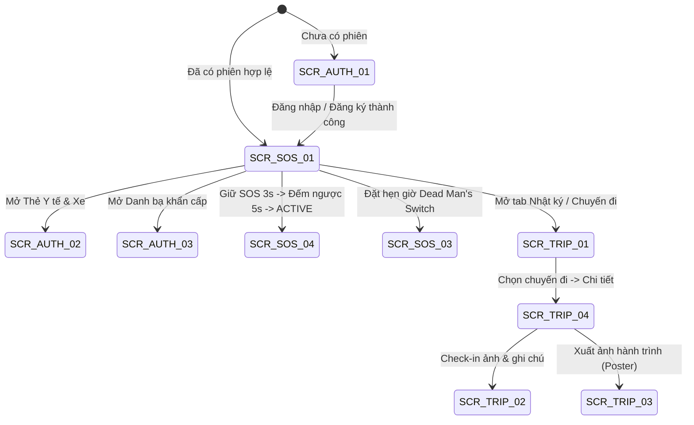
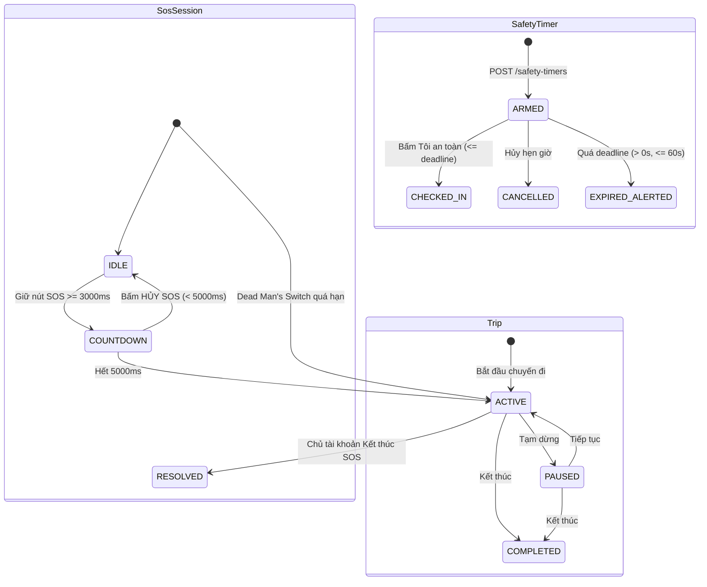

# Functional Specification Document (FSD): Cột Mốc Phase 1 MVP

## Metadata
- **Run ID**: `cot-moc-mvp-v2`
- **Document ID**: `FSD-COTMOC-001`
- **System**: Cột Mốc (`cot-moc`)
- **Module**: `auth_profile`, `sos_safety`, `trip_journal`
- **Date**: `2026-11-25`
- **Author**: `sdlc-ba-analysis`
- **Reviewed By**: `sdlc-sa-review`
- **Status**: `REWORK`
- **SRS Reference**: `artifacts/requirement-analysis.md`
- **Standard Conformance**: `ISO/IEC/IEEE 29148:2018 §9.5 & IEEE 1016-2009`

---

## 1. System Context, Screen Flow & State Machines

### 1.1 Screen Navigation Diagram

### 1.2 Domain State Machines

---

## 2. Functional Screen Specifications

### Màn hình: `SCR-AUTH-01` - Đăng ký & Đăng nhập
- **Route**: `/auth/login`, `/auth/register` | **Viewport**: `375px` | **RBAC**: `Guest`
- **States**: `Loading` (spinner nút Submit), `Error` (inline banner theo mã lỗi).
- **Field Inventory**:
| name | label | component_type | data_type | required | master_data_source | persistence_target | validation_rules |
|---|---|---|---|---|---|---|---|
| `identifier` | SĐT hoặc Email | Textbox | `VARCHAR(255)` | Yes | `N/A (user_input)` | `tbl_users.phone/email` | E.164/0xxx hoặc email |
| `password` | Mật khẩu | PasswordInput | `VARCHAR(128)` | Yes | `N/A (user_input)` | `tbl_users.password_hash` | 8..128 ký tự, >=1 chữ cái & >=1 số |
| `full_name` | Họ và tên | Textbox | `VARCHAR(100)` | Conditional | `N/A (user_input)` | `tbl_users.full_name` | Bắt buộc khi Đăng ký |
- **Data Contracts**: `POST /api/v1/auth/register`, `POST /api/v1/auth/login`.

### Màn hình: `SCR-AUTH-02` - Thẻ thông tin Y tế & Xe
- **Route**: `/profile/emergency-card` | **Viewport**: `375px` | **RBAC**: `AuthenticatedUser`
- **States**: `Loading` (skeleton form), `Error` (inline validation).
- **Field Inventory**:
| name | label | component_type | data_type | required | master_data_source | persistence_target | validation_rules |
|---|---|---|---|---|---|---|---|
| `blood_type` | Nhóm máu | Dropdown | `VARCHAR(10)` | Yes | `Static Enum` | `tbl_emergency_cards.blood_type` | `{A+,A-,B+,B-,AB+,AB-,O+,O-,UNKNOWN}` |
| `drug_allergies` | Dị ứng thuốc | Textarea | `VARCHAR(500)` | No | `N/A (user_input)` | `tbl_emergency_cards.drug_allergies` | Tối đa 500 ký tự |
| `medical_conditions` | Bệnh nền | Textarea | `VARCHAR(500)` | No | `N/A (user_input)` | `tbl_emergency_cards.medical_conditions` | Tối đa 500 ký tự |
| `vehicle_plate` | Biển số xe | Textbox | `VARCHAR(20)` | No | `N/A (user_input)` | `tbl_emergency_cards.vehicle_plate` | Tối đa 20 ký tự |
| `vehicle_model` | Loại xe | Textbox | `VARCHAR(100)` | No | `N/A (user_input)` | `tbl_emergency_cards.vehicle_model` | Tối đa 100 ký tự |
- **Data Contracts**: `PUT /api/v1/profile/emergency-card` (fallback SQLite `local_emergency_card`).

### Màn hình: `SCR-AUTH-03` - Danh sách & Quản lý Danh bạ khẩn cấp
- **Route**: `/profile/contacts` | **Viewport**: `375px` | **RBAC**: `AuthenticatedUser`
- **States**: `Loading`, `Empty` ("Chưa có người thân khẩn cấp — Thêm tối đa 5 liên hệ"), `Error` (chặn nút Thêm khi đủ 5).
- **Field Inventory**:
| name | label | component_type | data_type | required | master_data_source | persistence_target | validation_rules |
|---|---|---|---|---|---|---|---|
| `name` | Tên người thân | Textbox | `VARCHAR(100)` | Yes | `N/A (user_input)` | `tbl_emergency_contacts.name` | 1..100 ký tự |
| `phone` | Số điện thoại | PhoneInput | `VARCHAR(20)` | Yes | `N/A (user_input)` | `tbl_emergency_contacts.phone` | 10..15 chữ số; tối đa 5 liên hệ |
| `relationship` | Mối quan hệ | Textbox | `VARCHAR(50)` | Yes | `N/A (user_input)` | `tbl_emergency_contacts.relationship` | 1..50 ký tự |
| `delete_confirm` | Xác nhận xóa | ConfirmModal | `BOOLEAN` | Yes | `UI Action` | `DELETE /api/v1/contacts/{id}` | Xác nhận trước khi xóa |
- **Data Contracts**: `GET/POST/PUT/DELETE /api/v1/contacts`.

### Màn hình: `SCR-SOS-01` - Màn hình chính & Nút SOS 1 chạm
- **Route**: `/home` | **Viewport**: `375px` | **RBAC**: `AuthenticatedUser`
- **States**: `IDLE`, `HOLDING (0..3s)`, `COUNTDOWN (5..0s)`, `OfflineBanner`.
- **Field Inventory**:
| name | label | component_type | data_type | required | master_data_source | persistence_target | validation_rules |
|---|---|---|---|---|---|---|---|
| `hold_progress` | Tiến trình giữ nút | ProgressRing | `INTEGER` | Yes | `Device Timer` | `N/A (ephemeral)` | `>= 3000 ms` |
| `cancel_countdown` | Đếm ngược hủy | CountdownText | `INTEGER` | Yes | `Device Timer` | `N/A (ephemeral)` | `5 -> 0` giây |
| `latitude` | Vĩ độ | Coordinate | `DOUBLE` | Yes | `Device GPS` | `tbl_sos_sessions.latitude` | `-90..90` (hoặc last known) |
| `longitude` | Kinh độ | Coordinate | `DOUBLE` | Yes | `Device GPS` | `tbl_sos_sessions.longitude` | `-180..180` (hoặc last known) |
| `battery_level` | Mức pin (%) | Badge | `INTEGER` | Yes | `Device Battery` | `tbl_sos_sessions.battery_level` | `0..100` |
- **Data Contracts**: `POST /api/v1/sos/trigger` (timeout 5000ms) hoặc OS SMS Composer.

### Màn hình: `SCR-SOS-02` - Trang Web theo dõi trực tiếp cho người thân
- **Route**: `/track/{tracking_token}` | **Viewport**: `375px` & `1280px` | **RBAC**: `Public (Token-gated)`
- **States**: `Loading`, `ActiveSOS`, `ResolvedSOS` (ẩn thẻ y tế), `Expired/410`, `NotFound/404`.
- **Field Inventory**:
| name | label | component_type | data_type | required | master_data_source | persistence_target | validation_rules |
|---|---|---|---|---|---|---|---|
| `tracking_token` | Mã phiên | URL Param | `VARCHAR(64)` | Yes | `URL Path` | `tbl_sos_sessions.tracking_token` | Token hợp lệ, chưa hết hạn |
| `sos_status` | Trạng thái SOS | StatusBadge | `VARCHAR(20)` | Yes | `GET /api/v1/track/{token}/status` | `tbl_sos_sessions.status` | `ACTIVE` \| `RESOLVED` |
| `last_lat_lng` | Vị trí cuối | MapMarker | `DOUBLE` | Yes | `GET /api/v1/track/{token}/status` | `tbl_sos_sessions.latitude/longitude` | 6 chữ số thập phân |
| `battery_level` | Mức pin | Text | `INTEGER` | Yes | `GET /api/v1/track/{token}/status` | `tbl_sos_sessions.battery_level` | `0..100%` |
| `updated_at` | Cập nhật cuối | TimestampText | `TIMESTAMPTZ` | Yes | `GET /api/v1/track/{token}/status` | `tbl_sos_sessions.updated_at` | Định dạng `YYYY-MM-DD HH:mm` |
| `breadcrumb_trail` | Vệt di chuyển | PolylineMap | `JSONArray` | No | `GET /api/v1/track/{token}/status` | `tbl_trip_breadcrumbs / tbl_sos_locations` | Tối đa 50 điểm gần nhất |
| `medical_vehicle_card` | Thẻ Y tế & Xe | InfoCard | `JSONObject` | Conditional | `GET /api/v1/track/{token}/status` | `tbl_emergency_cards` | Chỉ hiển thị khi `sos_status == ACTIVE` |
- **Data Contracts**: `GET /track/{tracking_token}`, `GET /api/v1/track/{tracking_token}/status` (poll 15s).

### Màn hình: `SCR-SOS-03` - Hẹn giờ Check-in an toàn (Dead Man's Switch)
- **Route**: `/safety-timer` | **Viewport**: `375px` | **RBAC**: `AuthenticatedUser`
- **States**: `Unarmed`, `ArmedCountdown`, `ExpiredAlerted`, `Error`.
- **Field Inventory**:
| name | label | component_type | data_type | required | master_data_source | persistence_target | validation_rules |
|---|---|---|---|---|---|---|---|
| `deadline_at` | Mốc giờ an toàn | DateTimePicker | `TIMESTAMPTZ` | Yes | `N/A (user_input)` | `tbl_safety_timers.deadline_at` | `now + 5m <= deadline_at <= now + 72h` |
| `note` | Ghi chú lộ trình | Textbox | `VARCHAR(200)` | No | `N/A (user_input)` | `tbl_safety_timers.note` | Tối đa 200 ký tự |
| `status` | Trạng thái | Badge | `VARCHAR(24)` | Yes | `Server/Local` | `tbl_safety_timers.status` | `ARMED\|CHECKED_IN\|EXPIRED_ALERTED\|CANCELLED` |
| `extend_minutes` | Gia hạn | ButtonGroup | `INTEGER` | No | `Static {30, 60}` | `tbl_safety_timers.deadline_at` | Cộng dồn không quá +72h |
- **Data Contracts**: `POST /api/v1/safety-timers`, `/checkin`, `/extend`, `/cancel`, `/location`.

### Màn hình: `SCR-SOS-04` - Quản lý phiên SOS đang hoạt động
- **Route**: `/sos/active` | **Viewport**: `375px` | **RBAC**: `AuthenticatedUser`
- **States**: `ActiveOnline` (hiển thị link + nút Chia sẻ + Kết thúc + Thu hồi), `ActiveOffline` (huy hiệu chờ đồng bộ).
- **Field Inventory**:
| name | label | component_type | data_type | required | master_data_source | persistence_target | validation_rules |
|---|---|---|---|---|---|---|---|
| `sos_id` | Mã phiên SOS | Hidden/Text | `UUID` | Yes | `POST /api/v1/sos/trigger` | `tbl_sos_sessions.sos_id` | UUID hợp lệ |
| `tracking_url` | Link theo dõi | CopyableLink | `VARCHAR(255)` | Conditional | `POST /api/v1/sos/trigger` | `tbl_sos_sessions.tracking_token` | Có khi đã sync server |
| `resolve_action` | Tôi đã an toàn | DangerButton | `Action` | Yes | `UI Action` | `POST /api/v1/sos/{id}/resolve` | Chuyển `ACTIVE -> RESOLVED` |
| `revoke_action` | Thu hồi link | SecondaryButton | `Action` | No | `UI Action` | `POST /api/v1/sos/{id}/revoke-link` | Hết hạn link ngay (`410`) |
- **Data Contracts**: `POST /api/v1/sos/{id}/heartbeat`, `/resolve`, `/revoke-link`.

### Màn hình: `SCR-TRIP-01` - Quản lý & Lịch sử chuyến đi
- **Route**: `/trips` | **Viewport**: `375px` | **RBAC**: `AuthenticatedUser`
- **States**: `Loading`, `Empty` ("Chưa có chuyến đi nào"), `ActiveTripBar`, `Error`.
- **Field Inventory**:
| name | label | component_type | data_type | required | master_data_source | persistence_target | validation_rules |
|---|---|---|---|---|---|---|---|
| `title` | Tên chuyến đi | Textbox | `VARCHAR(120)` | No | `N/A (user_input)` | `tbl_trips.title` | Mặc định `'Chuyến đi YYYY-MM-DD HH:mm'` |
| `status` | Trạng thái | Badge | `VARCHAR(20)` | Yes | `Local/Server` | `tbl_trips.status` | `ACTIVE\|PAUSED\|COMPLETED` |
| `started_at` | Ngày thực hiện | DateText | `TIMESTAMPTZ` | Yes | `System Clock` | `tbl_trips.started_at` | Định dạng `YYYY-MM-DD HH:mm` |
| `distance_km` | Quãng đường | MetricText | `DECIMAL(10,2)` | Yes | `Calculated (Haversine)` | `tbl_trips.distance_km` | `>= 0.00` |
| `duration_seconds` | Thời gian đi | MetricText | `INTEGER` | Yes | `Calculated` | `tbl_trips.duration_seconds` | Không tính lúc `PAUSED` |
- **Data Contracts**: `GET/POST /api/v1/trips`, `/pause`, `/resume`, `/complete`.

### Màn hình: `SCR-TRIP-02` - Check-in ảnh & ghi chú trên bản đồ
- **Route**: `/trips/{id}/checkin` | **Viewport**: `375px` | **RBAC**: `AuthenticatedUser`
- **Field Inventory**:
| name | label | component_type | data_type | required | master_data_source | persistence_target | validation_rules |
|---|---|---|---|---|---|---|---|
| `image_path` | Ảnh check-in | ImagePicker/Camera | `VARCHAR(500)` | Yes | `Device Camera/Gallery` | `tbl_trip_checkins.image_path` | JPEG/PNG, nén 1920px, <= 10 MB |
| `note` | Ghi chú | Textarea | `VARCHAR(500)` | No | `N/A (user_input)` | `tbl_trip_checkins.note` | Tối đa 500 ký tự |
| `latitude` | Vĩ độ | Coordinate | `DOUBLE` | Yes | `Device GPS` | `tbl_trip_checkins.latitude` | `-90..90` |
| `longitude` | Kinh độ | Coordinate | `DOUBLE` | Yes | `Device GPS` | `tbl_trip_checkins.longitude` | `-180..180` |
| `altitude_m` | Độ cao (m) | NumberText | `DOUBLE` | No | `Device GPS` | `tbl_trip_checkins.altitude_m` | Số nguyên + ` m`, hoặc `-- m` |

### Màn hình: `SCR-TRIP-03` - Export ảnh tổng kết hành trình (Poster)
- **Route**: `/trips/{id}/export` | **Viewport**: `375px` | **RBAC**: `AuthenticatedUser`
- **Field Inventory**:
| name | label | component_type | data_type | required | master_data_source | persistence_target | validation_rules |
|---|---|---|---|---|---|---|---|
| `selected_photo_ids` | Ảnh nổi bật | MultiSelectGrid | `UUID[]` | Yes | `tbl_trip_checkins` | `N/A (export)` | `2 <= count <= 4` |
| `aspect_ratio` | Tỷ lệ khung hình | SegmentedControl | `VARCHAR(10)` | Yes | `Static {'9:16','1:1'}` | `N/A (export)` | `'9:16'` hoặc `'1:1'` |
| `privacy_trim_km` | Che đầu/cuối | SegmentedControl | `INTEGER` | Yes | `Static {0, 1, 2}` | `N/A (export)` | `{0, 1, 2}` km (cap 25% nếu ngắn) |
| `poster_output` | Ảnh tổng kết | Canvas/Image | `PNG/JPEG` | Yes | `Generated` | `Device Gallery` | `1080x1920` hoặc `1080x1080` |

### Màn hình: `SCR-TRIP-04` - Chi tiết chuyến đi & Bản đồ Check-in
- **Route**: `/trips/{id}` | **Viewport**: `375px` | **RBAC**: `AuthenticatedUser`
- **States**: `Loading`, `EmptyCheckins` ("Chưa có điểm check-in nào"), `OfflinePending` (huy hiệu `'Chờ đồng bộ'`).
- **Field Inventory**:
| name | label | component_type | data_type | required | master_data_source | persistence_target | validation_rules |
|---|---|---|---|---|---|---|---|
| `route_polyline` | Cung đường | MapPolyline | `LatLng[]` | Yes | `tbl_trip_breadcrumbs` | `tbl_trip_breadcrumbs` | Theo thứ tự `recorded_at` |
| `checkin_pins` | Điểm check-in | MapMarkers | `Checkin[]` | No | `tbl_trip_checkins` | `tbl_trip_checkins` | Hiển thị ảnh & ghi chú khi bấm |
| `sync_badge` | Trạng thái đồng bộ | StatusBadge | `VARCHAR(20)` | Yes | `SQLite` | `local_trip_checkins.sync_status` | `'Chờ đồng bộ'` khi `PENDING` |
| `export_cta` | Xuất ảnh hành trình | PrimaryButton | `Action` | Yes | `UI Action` | `Navigate SCR-TRIP-03` | Chỉ bật khi `status == COMPLETED` và `>= 2` ảnh |

---

## 3. Error Code to UI Message Mapping
| Error Code | HTTP | Screen | User-Facing Message (VI) |
|---|---|---|---|
| `ERR_AUTH_DUPLICATE_IDENTIFIER` | 409 | `SCR-AUTH-01` | Số điện thoại hoặc email đã được đăng ký. |
| `ERR_AUTH_WEAK_PASSWORD` | 422 | `SCR-AUTH-01` | Mật khẩu phải từ 8 ký tự trở lên, gồm cả chữ và số. |
| `ERR_AUTH_INVALID_CREDENTIALS` | 401 | `SCR-AUTH-01` | Sai thông tin đăng nhập hoặc mật khẩu. |
| `ERR_CONTACT_LIMIT_EXCEEDED` | 400 | `SCR-AUTH-03` | Bạn chỉ được lưu tối đa 5 liên hệ khẩn cấp. |
| `ERR_TIMER_ALREADY_ARMED` | 409 | `SCR-SOS-03` | Bạn đang có một hẹn giờ an toàn chưa hoàn thành. |
| `ERR_TIMER_ALREADY_EXPIRED` | 409 | `SCR-SOS-03` | Hẹn giờ đã quá hạn và hệ thống đã phát cảnh báo. |
| `ERR_TRIP_ALREADY_ACTIVE` | 409 | `SCR-TRIP-01` | Vui lòng kết thúc chuyến đi hiện tại trước khi tạo mới. |
| `ERR_CHECKIN_NOTE_TOO_LONG` | 422 | `SCR-TRIP-02` | Ghi chú không được vượt quá 500 ký tự. |
| `ERR_EXPORT_INVALID_PHOTO_COUNT` | - | `SCR-TRIP-03` | Vui lòng chọn từ 2 đến 4 ảnh check-in để xuất poster. |
| `ERR_TRACK_TOKEN_EXPIRED` | 410 | `SCR-SOS-02` | Liên kết theo dõi đã hết hạn hoặc bị thu hồi. |
