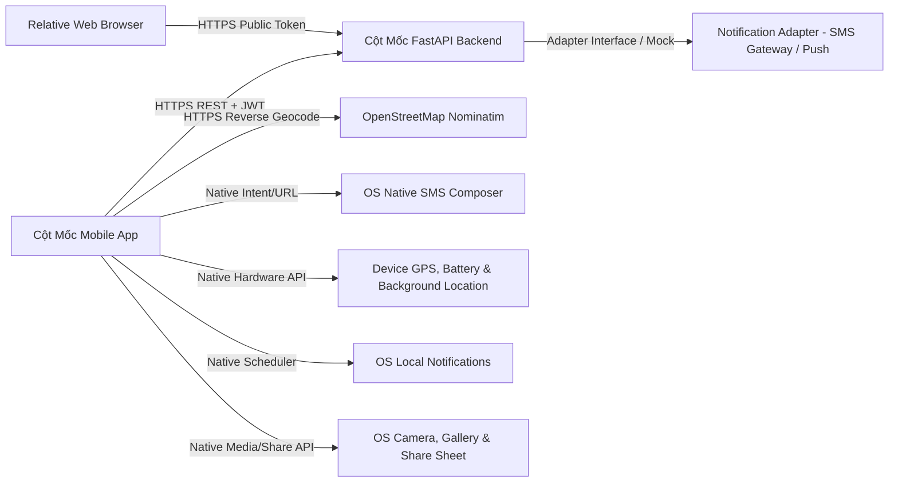

# External Interface Specification & Integration Matrix: Cột Mốc MVP

## Metadata
- **Run ID**: `cot-moc-mvp-v2`
- **System**: Cột Mốc (`cot-moc`)
- **Document ID**: `INT-SPEC-COTMOC-001`
- **Date**: `2026-11-25`
- **Author**: `sdlc-ba-analysis`
- **Reviewed By**: `sdlc-sa-review`
- **Standard Conformance**: `ISO/IEC/IEEE 29148:2018 §9.5.3.1`

---

## 1. External System Landscape & Boundary Topology

| External System | Provider / Owner | Trust Boundary | Primary Protocol | Timeout | Failure Fallback Strategy |
|---|---|---|---|---|---|
| **FastAPI Backend** | Internal (`backend/`) | App <-> Server | HTTPS REST / JSON + Multipart | 5000 ms (SOS), 10000 ms (Sync) | Lưu SQLite queue; SOS fallback sang OS SMS Composer |
| **Notification Adapter** | SMS Gateway + Push (Mockable) | Server -> External | HTTPS / Async Adapter | 5000 ms | Retry nền 3 lần (1s, 2s, 4s); lưu `delivery_status = PARTIAL_FAILED` |
| **OpenStreetMap Nominatim** | OSM Foundation | App -> External | HTTPS GET `/reverse` | 2000 ms | Fallback sang chuỗi tọa độ `'lat, lng'` 6 chữ số thập phân |
| **OS SMS Composer** | iOS / Android OS | On-device | Native SMS URI (`sms:`) | Instant | Hiển thị `ERR_SOS_NO_CONTACTS_OFFLINE` & gợi ý gọi 113/115 |
| **Device GPS & Background Location** | iOS / Android OS | On-device | Native Location API | 5000 ms | Dùng last known location (`is_stale_location = true`); từ chối quyền -> `ERR_LOCATION_PERMISSION_DENIED` |
| **OS Local Notifications** | iOS / Android OS | On-device | Native Notification API | Instant | Bỏ qua nhắc nhở cục bộ; server Dead Man's Switch vẫn hoạt động độc lập |
| **OS Gallery & Share Sheet** | iOS / Android OS | On-device | Native Media / Share API | Instant | Từ chối quyền lưu ảnh -> `ERR_EXPORT_STORAGE_PERMISSION_DENIED`, vẫn cho Share Sheet |

---

## 2. Complete Backend API Catalogue

### 2.1 Auth & Profile (`auth_profile`)
| Endpoint | Method | Request Schema | Success Response | Error Responses |
|---|---|---|---|---|
| `/api/v1/auth/register` | `POST` | `{ phone?, email?, password, full_name }` | `201`: `{ access_token, refresh_token, user }` | `409 ERR_AUTH_DUPLICATE_IDENTIFIER`, `422 ERR_AUTH_WEAK_PASSWORD` |
| `/api/v1/auth/login` | `POST` | `{ identifier, password }` | `200`: `{ access_token, refresh_token, user }` | `401 ERR_AUTH_INVALID_CREDENTIALS`, `429 ERR_RATE_LIMIT_EXCEEDED` |
| `/api/v1/auth/refresh` | `POST` | `{ refresh_token }` | `200`: `{ access_token, refresh_token }` | `401 ERR_AUTH_SESSION_EXPIRED` |
| `/api/v1/contacts` | `GET` | `Authorization: Bearer` | `200`: `[Contact]` | `401 Unauthorized` |
| `/api/v1/contacts` | `POST` | `{ name, phone, relationship, client_id? }` | `201`: `Contact` | `400 ERR_CONTACT_LIMIT_EXCEEDED`, `422 ERR_CONTACT_INVALID_PHONE` |
| `/api/v1/contacts/{id}` | `PUT` | `{ name, phone, relationship }` | `200`: `Contact` | `403 ERR_FORBIDDEN_RESOURCE`, `404 Not Found`, `422` |
| `/api/v1/contacts/{id}` | `DELETE` | `Authorization: Bearer` | `204 No Content` | `403 ERR_FORBIDDEN_RESOURCE`, `404 Not Found` |
| `/api/v1/profile/emergency-card` | `PUT` | `{ blood_type, drug_allergies?, medical_conditions?, vehicle_plate?, vehicle_model? }` | `200`: `EmergencyCard` | `422 ERR_PROFILE_INVALID_BLOOD_TYPE`, `422 ERR_PROFILE_FIELD_TOO_LONG` |

### 2.2 SOS, Web Tracking & Dead Man's Switch (`sos_safety`)
| Endpoint | Method | Request Schema | Success Response | Error Responses |
|---|---|---|---|---|
| `/api/v1/sos/trigger` | `POST` | `{ client_id?, trip_id?, latitude, longitude, battery_level, is_stale_location, triggered_offline?, recorded_at }` | `201`: `{ sos_id, tracking_token, tracking_url, delivery_status }` | `401 Unauthorized`, `422 Validation Error` |
| `/api/v1/sos/{id}/heartbeat` | `POST` | `{ latitude, longitude, battery_level, recorded_at }` | `200`: `{ status, updated_at }` | `403 ERR_FORBIDDEN_RESOURCE`, `409 ERR_SOS_NOT_ACTIVE` |
| `/api/v1/sos/{id}/resolve` | `POST` | `{}` | `200`: `{ status: "RESOLVED", ended_at, expires_at }` | `403 ERR_FORBIDDEN_RESOURCE`, `409 ERR_SOS_NOT_ACTIVE` |
| `/api/v1/sos/{id}/revoke-link` | `POST` | `{}` | `200`: `{ revoked_at, expires_at }` | `403 ERR_FORBIDDEN_RESOURCE`, `404 Not Found` |
| `/track/{tracking_token}` | `GET` | Public URL param | `200`: HTML page | `404 ERR_TRACK_TOKEN_NOT_FOUND`, `410 ERR_TRACK_TOKEN_EXPIRED`, `429` |
| `/api/v1/track/{tracking_token}/status` | `GET` | Public URL param | `200`: `{ status, latitude, longitude, battery_level, updated_at, emergency_card?, trail: [...] }` | `404 ERR_TRACK_TOKEN_NOT_FOUND`, `410 ERR_TRACK_TOKEN_EXPIRED`, `429` |
| `/api/v1/safety-timers` | `POST` | `{ deadline_at, note?, latitude?, longitude? }` | `201`: `SafetyTimer` | `409 ERR_TIMER_ALREADY_ARMED`, `422 ERR_TIMER_INVALID_DEADLINE` |
| `/api/v1/safety-timers/{id}/location` | `PUT` | `{ latitude, longitude }` | `200`: `SafetyTimer` | `403 ERR_FORBIDDEN_RESOURCE`, `409` |
| `/api/v1/safety-timers/{id}/checkin` | `POST` | `{}` | `200`: `{ status: "CHECKED_IN" }` | `403 ERR_FORBIDDEN_RESOURCE`, `409 ERR_TIMER_ALREADY_EXPIRED` |
| `/api/v1/safety-timers/{id}/extend` | `POST` | `{ extend_minutes: 30 | 60 }` | `200`: `SafetyTimer` | `409 ERR_TIMER_ALREADY_EXPIRED`, `422 ERR_TIMER_INVALID_DEADLINE` |
| `/api/v1/safety-timers/{id}/cancel` | `POST` | `{}` | `200`: `{ status: "CANCELLED" }` | `403 ERR_FORBIDDEN_RESOURCE`, `409` |

### 2.3 Trips, Breadcrumbs & Check-ins (`trip_journal`)
| Endpoint | Method | Request Schema | Success Response | Error Responses |
|---|---|---|---|---|
| `/api/v1/trips` | `GET` | `Authorization: Bearer` | `200`: `[Trip]` | `401 Unauthorized` |
| `/api/v1/trips` | `POST` | `{ client_id?, title?, started_at }` | `201`: `Trip` | `409 ERR_TRIP_ALREADY_ACTIVE` |
| `/api/v1/trips/{id}/pause` | `POST` | `{ paused_at }` | `200`: `Trip` | `403`, `409 ERR_TRIP_INVALID_STATE_TRANSITION` |
| `/api/v1/trips/{id}/resume` | `POST` | `{ resumed_at }` | `200`: `Trip` | `403`, `409 ERR_TRIP_INVALID_STATE_TRANSITION` |
| `/api/v1/trips/{id}/complete` | `POST` | `{ ended_at, distance_km, duration_seconds }` | `200`: `Trip` | `403`, `409 ERR_TRIP_INVALID_STATE_TRANSITION` |
| `/api/v1/trips/{id}/breadcrumbs` | `POST` | `{ items: [{ client_id, latitude, longitude, altitude_m?, speed_kmh?, accuracy_m, battery_level, recorded_at }] }` | `200`: `{ inserted_count }` | `403`, `422` |
| `/api/v1/trips/{id}/checkins` | `POST` | `multipart/form-data`: `client_id, latitude, longitude, is_stale_location, altitude_m?, location_name?, note?, captured_at, image` | `201`: `TripCheckin` | `403`, `422 ERR_CHECKIN_INVALID_IMAGE / ERR_CHECKIN_NOTE_TOO_LONG` |

---

## 3. Offline Sync Ordering & Dead-Letter Policy (`INT-04`)
1. **Dependency Ordering**: Worker đồng bộ luôn thực thi theo thứ tự: (1) `Contacts & EmergencyCard` -> (2) `Trips` -> (3) `Breadcrumbs & Checkins` (chỉ gửi khi `Trip` cha đã có `sync_status = SYNCED`) -> (4) `Deferred SOS`.
2. **Transient Failures (5xx / Network Timeout)**: Giữ `sync_status = PENDING`, retry với exponential backoff `5s, 15s, 45s`; nếu hết 3 lần vẫn lỗi mạng thì giữ `PENDING` và chờ sự kiện mạng `NetInfo` kết nối lại.
3. **Permanent Failures (4xx Dead-Letter Policy)**: Nếu server trả `HTTP 400/409/422` (lỗi nghiệp vụ không thể tự sửa như vượt 5 liên hệ), đánh dấu bản ghi cục bộ `sync_status = FAILED_PERMANENT`, lưu `last_sync_error` và hiển thị thông báo cho người dùng xử lý.
