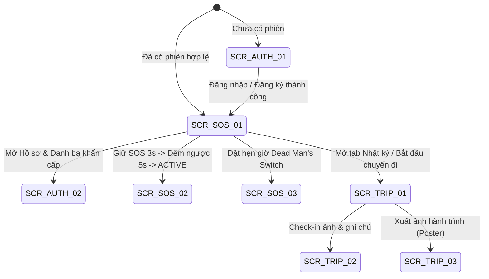

# Functional Specification Document (FSD): Cột Mốc Phase 1 MVP

## Metadata
- **Document ID**: `FSD-COTMOC-001`
- **System**: Cột Mốc (`cot-moc`)
- **Module**: `auth_profile`, `sos_safety`, `trip_journal`
- **Date**: `2026-11-25`
- **Author**: `sdlc-ba-analysis`
- **Reviewed By**: `sdlc-sa-review`
- **Status**: `DRAFT`
- **SRS Reference**: `artifacts/requirement-analysis.md`
- **Standard Conformance**: `ISO/IEC/IEEE 29148:2018 §9.5 & IEEE 1016-2009`

---

## 1. System Context & Screen Flow Navigation

---

## 2. Functional Screen Specifications

### Màn hình: `SCR-AUTH-01` - Đăng ký & Đăng nhập
- **Mã Màn Hình**: `SCR-AUTH-01`
- **Module**: `auth_profile`
- **Route**: `/auth/login`, `/auth/register`
- **Responsive Viewport**: Mobile `375px`
- **Authorized RBAC Roles**: `Guest`

#### Khối 1: Bố cục & Các phân vùng
1. **Header**: Logo Cột Mốc, nút chuyển đổi tab `Đăng nhập` / `Đăng ký`.
2. **Form Section**: Trường SĐT/Email, mật khẩu, họ tên (chỉ khi Đăng ký).
3. **Action Bar**: Nút `Đăng nhập` / `Đăng ký`, hiển thị thông báo lỗi inline.

#### Khối 2: Bảng danh mục trường dữ liệu (8 cột)
| name | label | component_type | data_type | required | master_data_source | persistence_target | validation_rules |
|---|---|---|---|---|---|---|---|
| `identifier` | SĐT hoặc Email | Textbox | `VARCHAR(255)` | Yes | `N/A (user_input)` | `tbl_users.phone` / `email` | E.164/0xxx hoặc email hợp lệ |
| `password` | Mật khẩu | PasswordInput | `VARCHAR(128)` | Yes | `N/A (user_input)` | `tbl_users.password_hash` | Tối thiểu 8 ký tự |
| `full_name` | Họ và tên | Textbox | `VARCHAR(100)` | Conditional | `N/A (user_input)` | `tbl_users.full_name` | Bắt buộc khi Đăng ký, 1..100 ký tự |
| `remember_session` | Duy trì phiên | Hidden/Auto | `BOOLEAN` | Yes | `N/A (system)` | `SecureStore` | Luôn lưu JWT an toàn |

#### Khối 3: Hợp đồng dữ liệu
- `POST /api/v1/auth/register` -> `{ access_token, refresh_token, user }`
- `POST /api/v1/auth/login` -> `{ access_token, refresh_token, user }`

#### Khối 4: Ánh xạ cơ sở dữ liệu
- **Bảng tác động**: `tbl_users`

#### Khối 5: Logic tương tác
- **`onSubmit`**: Validate định dạng cục bộ -> gọi API -> lưu JWT vào `SecureStore` -> điều hướng `SCR-SOS-01`.

---

### Màn hình: `SCR-AUTH-02` - Danh bạ khẩn cấp & Thẻ Y tế / Xe
- **Mã Màn Hình**: `SCR-AUTH-02`
- **Module**: `auth_profile`
- **Route**: `/profile/emergency`
- **Responsive Viewport**: Mobile `375px`
- **Authorized RBAC Roles**: `AuthenticatedUser`

#### Khối 1: Bố cục & Các phân vùng
1. **Contacts List Section**: Danh sách tối đa 5 liên hệ khẩn cấp kèm nút Thêm/Sửa/Xóa.
2. **Medical & Vehicle Card Section**: Form thông tin nhóm máu, dị ứng, bệnh nền, biển số và loại xe.

#### Khối 2: Bảng danh mục trường dữ liệu (8 cột)
| name | label | component_type | data_type | required | master_data_source | persistence_target | validation_rules |
|---|---|---|---|---|---|---|---|
| `contact_name` | Tên người thân | Textbox | `VARCHAR(100)` | Yes | `N/A (user_input)` | `tbl_emergency_contacts.name` | 1..100 ký tự |
| `contact_phone` | Số điện thoại | PhoneInput | `VARCHAR(20)` | Yes | `N/A (user_input)` | `tbl_emergency_contacts.phone` | 10..15 chữ số; tối đa 5 liên hệ |
| `relationship` | Mối quan hệ | Textbox | `VARCHAR(50)` | Yes | `N/A (user_input)` | `tbl_emergency_contacts.relationship` | 1..50 ký tự |
| `blood_type` | Nhóm máu | Dropdown | `VARCHAR(10)` | Yes | `Static Enum` | `tbl_emergency_cards.blood_type` | `{A+,A-,B+,B-,AB+,AB-,O+,O-,UNKNOWN}` |
| `drug_allergies` | Dị ứng thuốc | Textarea | `VARCHAR(500)` | No | `N/A (user_input)` | `tbl_emergency_cards.drug_allergies` | Tối đa 500 ký tự |
| `vehicle_plate` | Biển số xe | Textbox | `VARCHAR(20)` | No | `N/A (user_input)` | `tbl_emergency_cards.vehicle_plate` | Tối đa 20 ký tự |

#### Khối 3: Hợp đồng dữ liệu
- `GET/POST/PUT/DELETE /api/v1/contacts`, `PUT /api/v1/profile/emergency-card`. Fallback: SQLite cục bộ.

#### Khối 4: Ánh xạ cơ sở dữ liệu
- **Bảng tác động**: `tbl_emergency_contacts`, `tbl_emergency_cards`

#### Khối 5: Logic tương tác
- **`onSubmit`**: Ghi SQLite trước (`sync_status = PENDING`), đồng bộ API ngay nếu online.

---

### Màn hình: `SCR-SOS-01` - Màn hình chính & Nút SOS 1 chạm
- **Mã Màn Hình**: `SCR-SOS-01`
- **Module**: `sos_safety`
- **Route**: `/home`
- **Responsive Viewport**: Mobile `375px`
- **Authorized RBAC Roles**: `AuthenticatedUser`

#### Khối 1: Bố cục & Các phân vùng
1. **Status Bar**: Trạng thái mạng (`Online`/`Offline`), GPS lock, % pin, timer Dead Man's Switch đang chạy (nếu có).
2. **SOS Trigger Zone**: Nút SOS tròn kích thước lớn (giữ 3s) + vòng tiến trình + màn hình đếm ngược 5s kèm nút `HỦY SOS`.
3. **Quick Actions**: Bắt đầu/Xem chuyến đi, Hẹn giờ an toàn, Hồ sơ khẩn cấp.

#### Khối 2: Bảng danh mục trường dữ liệu (8 cột)
| name | label | component_type | data_type | required | master_data_source | persistence_target | validation_rules |
|---|---|---|---|---|---|---|---|
| `hold_progress` | Tiến trình giữ nút | ProgressRing | `INTEGER` | Yes | `Device Timer` | `N/A (ephemeral)` | `>= 3000 ms` mới kích hoạt đếm ngược |
| `cancel_countdown` | Đếm ngược hủy | CountdownText | `INTEGER` | Yes | `Device Timer` | `N/A (ephemeral)` | `5 -> 0` giây |
| `latitude` | Vĩ độ | Coordinate | `DOUBLE` | Yes | `Device GPS` | `tbl_sos_sessions.latitude` | `-90..90` (hoặc last known) |
| `longitude` | Kinh độ | Coordinate | `DOUBLE` | Yes | `Device GPS` | `tbl_sos_sessions.longitude` | `-180..180` (hoặc last known) |
| `battery_level` | Mức pin (%) | Badge | `INTEGER` | Yes | `Device Battery` | `tbl_sos_sessions.battery_level` | `0..100` |

#### Khối 3: Hợp đồng dữ liệu
- `POST /api/v1/sos/trigger` (timeout 5000ms); Offline fallback -> OS SMS Composer.

#### Khối 4: Ánh xạ cơ sở dữ liệu
- **Bảng tác động**: `tbl_sos_sessions`

#### Khối 5: Logic tương tác
- **`onPressHold(3000ms)`**: Rung haptic -> mở overlay đếm ngược 5s. Hết 5s -> kiểm tra mạng -> gọi API hoặc mở SMS Composer.

---

### Màn hình: `SCR-SOS-02` - Trang Web theo dõi trực tiếp cho người thân
- **Mã Màn Hình**: `SCR-SOS-02`
- **Module**: `sos_safety`
- **Route**: `/track/{tracking_token}` (FastAPI Web)
- **Responsive Viewport**: Mobile `375px` & Desktop `1280px`
- **Authorized RBAC Roles**: `Public (Token-gated)`

#### Khối 1: Bố cục & Các phân vùng
1. **Alert Banner**: Trạng thái SOS (`ACTIVE` / `RESOLVED`), thời điểm cập nhật cuối, % pin.
2. **Map / Location Panel**: Tọa độ GPS cuối cùng + link mở Google Maps + vệt 50 điểm breadcrumb gần nhất.
3. **Medical & Vehicle Card**: Nhóm máu, dị ứng, bệnh nền, biển số xe (hiển thị khi đang SOS).

#### Khối 2: Bảng danh mục trường dữ liệu (8 cột)
| name | label | component_type | data_type | required | master_data_source | persistence_target | validation_rules |
|---|---|---|---|---|---|---|---|
| `tracking_token` | Mã phiên | URL Param | `VARCHAR(64)` | Yes | `URL Path` | `tbl_sos_sessions.tracking_token` | Token hợp lệ và `expires_at > now` |
| `sos_status` | Trạng thái SOS | StatusBadge | `VARCHAR(20)` | Yes | `GET /api/v1/track/{token}/status` | `tbl_sos_sessions.status` | `ACTIVE` \| `RESOLVED` |
| `last_lat_lng` | Vị trí cuối | MapMarker | `DOUBLE` | Yes | `GET /api/v1/track/{token}/status` | `tbl_sos_sessions.latitude/longitude` | Định dạng 6 chữ số thập phân |
| `battery_level` | Mức pin | Text | `INTEGER` | Yes | `GET /api/v1/track/{token}/status` | `tbl_sos_sessions.battery_level` | `0..100%` |

#### Khối 3: Hợp đồng dữ liệu
- `GET /track/{tracking_token}` (HTML), `GET /api/v1/track/{tracking_token}/status` (JSON polling mỗi 15s).

#### Khối 4: Ánh xạ cơ sở dữ liệu
- **Bảng tác động**: `tbl_sos_sessions`, `tbl_trip_breadcrumbs`, `tbl_emergency_cards`

#### Khối 5: Logic tương tác
- **`onLoad`**: Render trạng thái hiện tại -> khởi tạo interval 15s gọi `/status` cập nhật DOM.

---

### Màn hình: `SCR-SOS-03` - Hẹn giờ Check-in an toàn (Dead Man's Switch)
- **Mã Màn Hình**: `SCR-SOS-03`
- **Module**: `sos_safety`
- **Route**: `/safety-timer`
- **Responsive Viewport**: Mobile `375px`
- **Authorized RBAC Roles**: `AuthenticatedUser`

#### Khối 1: Bố cục & Các phân vùng
1. **Timer Setup**: Chọn thời gian dự kiến an toàn (`deadline_at`).
2. **Active Timer Panel**: Đồng hồ đếm ngược, nút `Tôi an toàn` và nút `Gia hạn (+30p / +60p)`.

#### Khối 2: Bảng danh mục trường dữ liệu (8 cột)
| name | label | component_type | data_type | required | master_data_source | persistence_target | validation_rules |
|---|---|---|---|---|---|---|---|
| `deadline_at` | Mốc giờ an toàn | DateTimePicker | `TIMESTAMPTZ` | Yes | `N/A (user_input)` | `tbl_safety_timers.deadline_at` | `now + 5m <= deadline_at <= now + 72h` |
| `note` | Ghi chú lộ trình | Textbox | `VARCHAR(200)` | No | `N/A (user_input)` | `tbl_safety_timers.note` | Tối đa 200 ký tự |
| `status` | Trạng thái | Badge | `VARCHAR(24)` | Yes | `Server/Local` | `tbl_safety_timers.status` | `ARMED\|CHECKED_IN\|EXPIRED_ALERTED\|CANCELLED` |
| `extend_minutes` | Gia hạn | ButtonGroup | `INTEGER` | No | `Static {30, 60}` | `tbl_safety_timers.deadline_at` | Cộng dồn không quá +72h |

#### Khối 3: Hợp đồng dữ liệu
- `POST /api/v1/safety-timers`, `POST /api/v1/safety-timers/{id}/checkin`.

#### Khối 4: Ánh xạ cơ sở dữ liệu
- **Bảng tác động**: `tbl_safety_timers`

#### Khối 5: Logic tương tác
- **`onSubmit`**: Validate `deadline_at >= now + 5m` -> gửi API + đặt local notification nhắc trước 10 phút.

---

### Màn hình: `SCR-TRIP-01` - Quản lý & Lịch sử chuyến đi
- **Mã Màn Hình**: `SCR-TRIP-01`
- **Module**: `trip_journal`
- **Route**: `/trips`
- **Responsive Viewport**: Mobile `375px`
- **Authorized RBAC Roles**: `AuthenticatedUser`

#### Khối 1: Bố cục & Các phân vùng
1. **Active Trip Controls**: Tên chuyến đi, tổng `km`, thời gian di chuyển, nút `Bắt đầu` / `Tạm dừng` / `Tiếp tục` / `Kết thúc`.
2. **Trip History List**: Danh sách các chuyến đi đã hoàn thành kèm nút mở Chi tiết / Xuất Poster.

#### Khối 2: Bảng danh mục trường dữ liệu (8 cột)
| name | label | component_type | data_type | required | master_data_source | persistence_target | validation_rules |
|---|---|---|---|---|---|---|---|
| `title` | Tên chuyến đi | Textbox | `VARCHAR(120)` | Yes | `N/A (user_input)` | `tbl_trips.title` | Mặc định `'Chuyến đi YYYY-MM-DD'` |
| `status` | Trạng thái | Badge | `VARCHAR(20)` | Yes | `Local/Server` | `tbl_trips.status` | `ACTIVE\|PAUSED\|COMPLETED` |
| `distance_km` | Quãng đường | MetricText | `DECIMAL(10,2)` | Yes | `Calculated (Haversine)` | `tbl_trips.distance_km` | `>= 0.00` |
| `duration_seconds` | Thời gian đi | MetricText | `INTEGER` | Yes | `Calculated` | `tbl_trips.duration_seconds` | Không tính lúc `PAUSED` |

#### Khối 3: Hợp đồng dữ liệu
- `GET/POST /api/v1/trips`, `POST /api/v1/trips/{id}/pause`, `POST /api/v1/trips/{id}/resume`, `POST /api/v1/trips/{id}/complete`.

#### Khối 4: Ánh xạ cơ sở dữ liệu
- **Bảng tác động**: `tbl_trips`, `tbl_trip_breadcrumbs`

#### Khối 5: Logic tương tác
- **`onStart`**: Kiểm tra không có chuyến `ACTIVE`/`PAUSED` -> tạo record SQLite -> bật dịch vụ ghi breadcrumb nền.

---

### Màn hình: `SCR-TRIP-02` - Check-in ảnh & ghi chú trên bản đồ
- **Mã Màn Hình**: `SCR-TRIP-02`
- **Module**: `trip_journal`
- **Route**: `/trips/{id}/checkin`
- **Responsive Viewport**: Mobile `375px`
- **Authorized RBAC Roles**: `AuthenticatedUser`

#### Khối 1: Bố cục & Các phân vùng
1. **Photo Preview**: Ảnh chụp/chọn kèm lớp phủ watermark (`Địa điểm/Tọa độ | Độ cao m | Ngày giờ`).
2. **Note & Location Form**: Ghi chú, tọa độ GPS hiện tại, nút `Lưu Check-in`.

#### Khối 2: Bảng danh mục trường dữ liệu (8 cột)
| name | label | component_type | data_type | required | master_data_source | persistence_target | validation_rules |
|---|---|---|---|---|---|---|---|
| `image_file` | Ảnh check-in | ImagePicker/Camera | `BLOB/URI` | Yes | `Device Camera/Gallery` | `tbl_trip_checkins.image_url` | JPEG/PNG, <= 10 MB |
| `note` | Ghi chú | Textarea | `VARCHAR(500)` | No | `N/A (user_input)` | `tbl_trip_checkins.note` | Tối đa 500 ký tự |
| `latitude` | Vĩ độ | Coordinate | `DOUBLE` | Yes | `Device GPS` | `tbl_trip_checkins.latitude` | `-90..90` |
| `longitude` | Kinh độ | Coordinate | `DOUBLE` | Yes | `Device GPS` | `tbl_trip_checkins.longitude` | `-180..180` |
| `altitude_m` | Độ cao (m) | NumberText | `DOUBLE` | No | `Device GPS` | `tbl_trip_checkins.altitude_m` | Hiển thị `-- m` nếu null |

#### Khối 3: Hợp đồng dữ liệu
- `POST /api/v1/trips/{trip_id}/checkins` (multipart/form-data); Offline -> SQLite queue (`sync_status = PENDING`).

#### Khối 4: Ánh xạ cơ sở dữ liệu
- **Bảng tác động**: `tbl_trip_checkins`

#### Khối 5: Logic tương tác
- **`onPhotoCaptured`**: Render watermark ngay trên thiết bị -> lưu ảnh + metadata vào SQLite -> đẩy vào sync queue.

---

### Màn hình: `SCR-TRIP-03` - Export ảnh tổng kết hành trình (Poster)
- **Mã Màn Hình**: `SCR-TRIP-03`
- **Module**: `trip_journal`
- **Route**: `/trips/{id}/export`
- **Responsive Viewport**: Mobile `375px`
- **Authorized RBAC Roles**: `AuthenticatedUser`

#### Khối 1: Bố cục & Các phân vùng
1. **Photo Selector**: Chọn 2–4 ảnh check-in từ chuyến đi.
2. **Export Options**: Tỷ lệ (`9:16` / `1:1`) và tùy chọn che đầu/cuối (`0 km`, `1 km`, `2 km`).
3. **Poster Preview & Actions**: Xem trước poster đã vẽ cung đường + ảnh + thông số; nút `Lưu về máy` / `Chia sẻ`.

#### Khối 2: Bảng danh mục trường dữ liệu (8 cột)
| name | label | component_type | data_type | required | master_data_source | persistence_target | validation_rules |
|---|---|---|---|---|---|---|---|
| `selected_photo_ids` | Ảnh nổi bật | MultiSelectGrid | `UUID[]` | Yes | `tbl_trip_checkins` | `N/A (export)` | `2 <= count <= 4` |
| `aspect_ratio` | Tỷ lệ khung hình | SegmentedControl | `VARCHAR(10)` | Yes | `Static {'9:16','1:1'}` | `N/A (export)` | `'9:16'` hoặc `'1:1'` |
| `privacy_trim_km` | Che đầu/cuối | SegmentedControl | `INTEGER` | Yes | `Static {0, 1, 2}` | `N/A (export)` | `{0, 1, 2}` km |
| `poster_output` | Ảnh tổng kết | Canvas/Image | `PNG/JPEG` | Yes | `Generated` | `Device Gallery` | `1080x1920` hoặc `1080x1080` |

#### Khối 3: Hợp đồng dữ liệu
- Xử lý hoàn toàn trên thiết bị (offline-capable) từ dữ liệu SQLite (`tbl_trips`, `tbl_trip_breadcrumbs`, `tbl_trip_checkins`).

#### Khối 4: Ánh xạ cơ sở dữ liệu
- **Bảng tác động**: Đọc từ `tbl_trips`, `tbl_trip_breadcrumbs`, `tbl_trip_checkins`.

#### Khối 5: Logic tương tác
- **`onExport`**: Cắt `privacy_trim_km` đầu/cuối -> render poster -> mở OS Share Sheet hoặc lưu thư viện ảnh.
