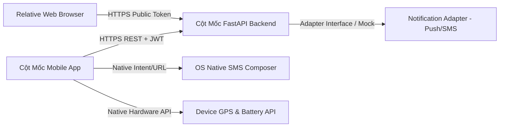

# External Interface Specification & Integration Matrix: Cột Mốc MVP

## Metadata
- **System**: Cột Mốc (`cot-moc`)
- **Document ID**: `INT-SPEC-COTMOC-001`
- **Date**: `2026-11-25`
- **Author**: `sdlc-ba-analysis`
- **Reviewed By**: `sdlc-sa-review`
- **Standard Conformance**: `ISO/IEC/IEEE 29148:2018 §9.5.3.1`

---

## 1. External System Landscape & Boundary Topology

| External System | Provider | Trust Boundary | Primary Protocol | Criticality | Impact of Downtime |
|---|---|---|---|---|---|
| **FastAPI Backend** | Internal (`backend/`) | App <-> Server | HTTPS REST / JSON + Multipart | Tier 1 | Mobile chuyển sang chế độ offline-first; SOS dùng SMS Fallback |
| **OS SMS Composer** | iOS / Android OS | On-device | Native SMS URI (`sms:`) | Tier 1 | Không gửi được SMS fallback khi mất sóng |
| **Device GPS & Battery** | iOS / Android OS | On-device | Native Location/Battery API | Tier 1 | SOS dùng tọa độ cuối cùng đã lưu |
| **Notification Adapter** | FCM / SMS Gateway (Mockable) | Server -> External | HTTPS / Async Adapter | Tier 2 | SOS vẫn lưu thành công, retry nền 3 lần |

---

## 2. Detailed Interface Contracts

### 2.1 `INT-01`: Mobile -> Backend SOS Trigger
- **Endpoint**: `POST /api/v1/sos/trigger`
- **Auth**: `Authorization: Bearer <access_token>`
- **Timeout**: `5000 ms` (vượt ngưỡng tự động fallback sang `INT-02` OS SMS Composer)
- **Payload**: `{ "latitude": 21.028511, "longitude": 105.804817, "battery_level": 42, "is_stale_location": false, "recorded_at": "2026-11-25T10:30:00Z" }`
- **Response (`201 Created`)**: `{ "sos_id": "...", "tracking_token": "...", "tracking_url": "/track/...", "delivery_status": "SENT" }`

### 2.2 `INT-02`: Mobile -> OS SMS Composer (Offline Fallback)
- **Direction**: On-device
- **Payload**: Danh sách SĐT từ SQLite `tbl_emergency_contacts` + Nội dung `[COT MOC SOS] Toi dang can ho tro! Vi tri: https://maps.google.com/?q=<lat>,<lng> | Pin: <battery>% | Nhom mau: <blood> | Di ung: <allergy> | Bien so: <plate>`.

### 2.3 `INT-03`: Backend -> Notification Adapter (Push / SMS Gateway)
- **Direction**: Server Outbound
- **Behavior**: Giao diện `NotificationAdapter` cho phép cắm FCM/SMS provider thực tế ở production và `MockNotificationAdapter` trong dev/test.
- **Retry**: 3 lần với backoff (1s, 2s, 4s); lỗi không làm fail `POST /api/v1/sos/trigger`.

### 2.4 `INT-04`: Mobile -> Backend Offline Sync (`breadcrumbs`, `checkins`, `trips`, `contacts`)
- **Idempotency**: Mỗi bản ghi mang `client_id` (UUIDv4) để chống trùng lặp khi mạng chập chờn.
- **Retry**: Exponential backoff (5s, 15s, 45s) khi thiết bị có mạng trở lại.
