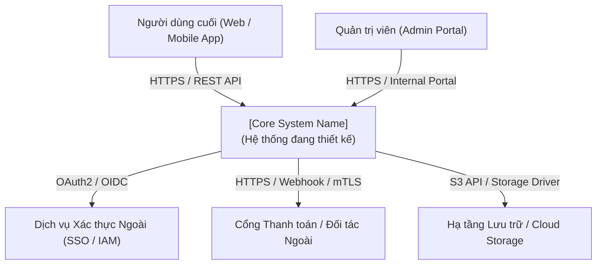
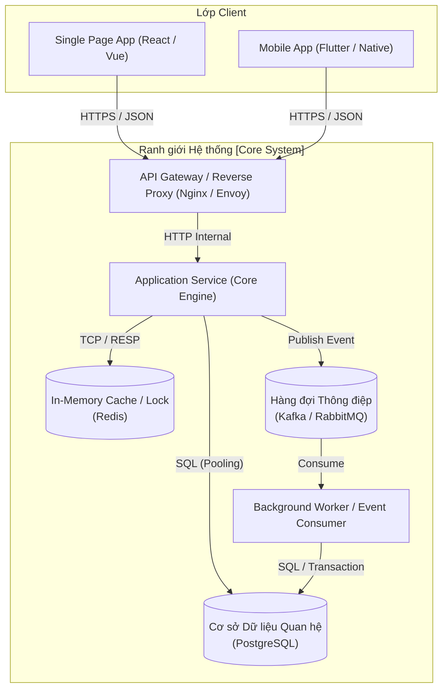
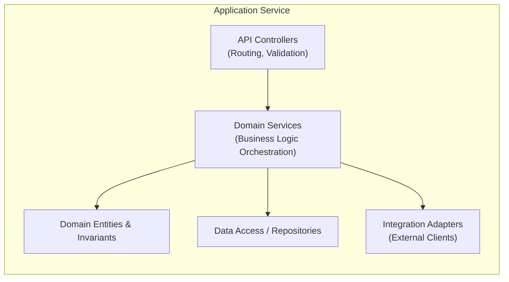
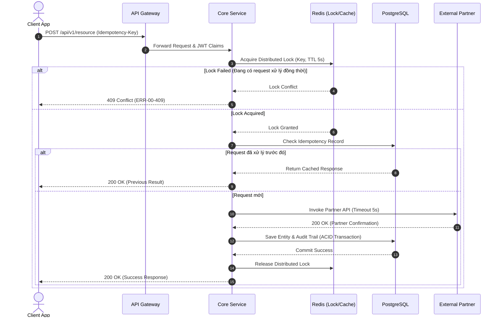
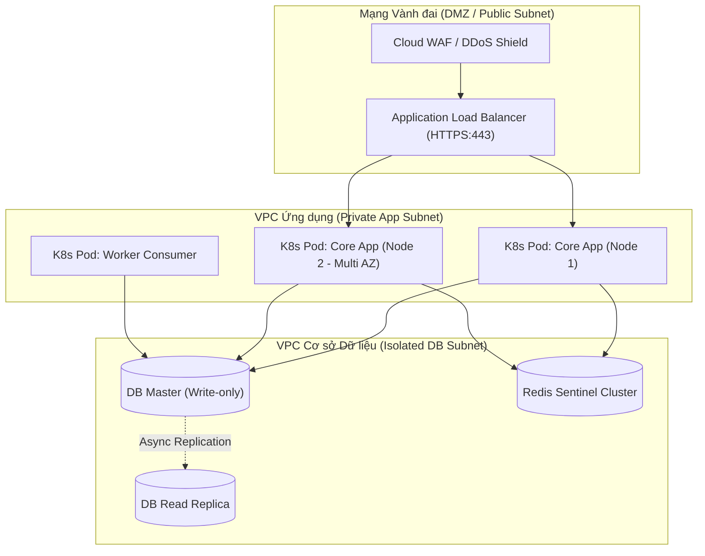

# Solution Architecture Document (arc42 Standard)

**Hệ thống / Dự án**: `[Project Name]`  
**Mục tiêu**: Đặc tả kiến trúc kỹ thuật cấp cao và chi tiết giải pháp theo chuẩn quốc tế **arc42** kết hợp mô hình hóa **C4 Model**.  
**Trạng thái**: `Đề xuất` | **Chủ trì**: `Software Architect (SA)` | **Liên kết mục lục**: [00-document-index.md](00-document-index.md)

---

## 1. Introduction and Goals (Giới thiệu và Mục tiêu)

### 1.1. Mục tiêu Nghiệp vụ (Business Goals)
- **Mục tiêu 1 (G-01)**: `[Mô tả mục tiêu nghiệp vụ chính cần đạt được của hệ thống/chức năng]`
- **Mục tiêu 2 (G-02)**: `[Mô tả mục tiêu tối ưu hiệu năng hoặc tự động hóa quy trình]`
- **Mục tiêu 3 (G-03)**: `[Mục tiêu tuân thủ chuẩn mở, khả năng bảo trì và giảm thiểu nợ kỹ thuật]`

### 1.2. Các Bên Liên quan (Stakeholders)
| Vai trò / Stakeholder | Kỳ vọng chính từ Kiến trúc | Trách nhiệm tương tác |
| :--- | :--- | :--- |
| **Product Owner (PO)** | Tính năng bàn giao đúng tiến độ, đúng MVP scope, đáp ứng trải nghiệm người dùng | Cung cấp và làm rõ nghiệp vụ |
| **Software Architect (SA)** | Kiến trúc module hóa, bền vững, dễ mở rộng, kiểm soát rủi ro kỹ thuật | Chủ trì thiết kế và giám sát chuẩn |
| **Technical Reviewer** | Tính chặt chẽ của các quyết định ADR, bảo mật và tính khả thi | Thẩm định và ra quyết định phê duyệt |
| **Development Team** | Interface contract DTO rõ ràng, boundary chuẩn xác, dễ triển khai test TDD | Thi hành code theo đúng thiết kế |
| **QA / Tester** | NFR đo lường được, luồng runtime minh bạch, dễ viết test case biên | Kiểm thử độc lập và xác nhận SLA |
| **DevOps / SRE** | Khả năng giám sát (Observability), triển khai zero-downtime, cấu hình chuẩn | Quản trị vận hành và hạ tầng |

### 1.3. Yêu cầu Chất lượng Cốt lõi (Quality Goals)
1. **Reliability & Availability**: Đảm bảo tính liên tục của các giao dịch trọng yếu, xử lý retry an toàn và không gây trùng lặp.
2. **Performance & Scalability**: Thời gian đáp ứng sub-second cho các API core, khả năng mở rộng theo chiều ngang (horizontal scaling).
3. **Maintainability & Decoupling**: Đảm bảo tính độc lập giữa các module, không rò rỉ phụ thuộc chéo (no cyclic dependency, strict domain boundaries).

---

## 2. Architecture Constraints (Ràng buộc Kiến trúc)

### 2.1. Ràng buộc Kỹ thuật (Technical Constraints)
- **Tech Stack**: `[Ngôn ngữ: Python 3.11+ / Go / Java / Node.js; Framework: FastAPI / Spring Boot / Express...]`
- **Hệ cơ sở dữ liệu**: `[PostgreSQL / MySQL / MongoDB / Redis...]`
- **Tương thích ngược**: Phải duy trì tương thích 100% với các schema dữ liệu và API hiện hữu của các dịch vụ xung quanh.
- **Ranh giới công nghệ**: `[Khai báo các thư viện bắt buộc hoặc các công nghệ bị cấm sử dụng]`

### 2.2. Ràng buộc Tổ chức & Quy trình (Organizational Constraints)
- Quy trình kiểm soát SDLC: Tuân thủ quy trình kiểm soát độc lập của `SDLC Harness` (Producer / Challenger separation).
- Giới hạn phân phối: Mỗi Work Item trong Implementation Plan phải có ranh giới file rõ ràng (`Create`, `Modify`, `Test`).

### 2.3. Ràng buộc Pháp lý & Tuân thủ (Regulatory Constraints)
- Tuân thủ quy định bảo vệ dữ liệu cá nhân (PDPA / GDPR).
- Mã hóa dữ liệu nhạy cảm (PII, credentials, token) khi lưu trữ (at-rest) và khi truyền tải (in-transit).

---

## 3. Context and Scope (Bối cảnh và Phạm vi)

### 3.1. Bối cảnh Hệ thống (C4 Level 1 - System Context Diagram)



### 3.2. Ranh giới Trách nhiệm & Phạm vi (Scope & Responsibilities)
- **Bên trong Phạm vi (In-Scope)**:
  - Cung cấp các API nghiệp vụ chính theo đặc tả [04-integration/openapi.yaml](04-integration/openapi.yaml).
  - Quản lý vòng đời trạng thái của các thực thể dữ liệu nghiệp vụ cốt lõi.
  - Xử lý xác thực, ủy quyền (RBAC) và lưu vết kiểm toán (audit log).
- **Ngoài Phạm vi (Out-of-Scope)**:
  - Quản lý tài khoản gốc (được ủy quyền cho Identity Provider bên ngoài).
  - Xử lý hạch toán tài chính cấp ngân hàng trung ương (ủy quyền cho Core Banking / Payment Provider).

### 3.3. Giao diện Bên ngoài (External Interfaces)
| Giao diện | Loại tương tác | Giao thức | Cơ chế Xác thực | Xử lý Sự cố / Fallback |
| :--- | :--- | :--- | :--- | :--- |
| `IDP_AUTH` | Outbound | HTTPS / REST | Bearer Token / JWKS | Cache token nội bộ, timeout 3s |
| `PAYMENT_GW` | Outbound | HTTPS / REST | API Key + Signature / mTLS | Retry tối đa 3 lần với Exponential Backoff |
| `CLIENT_API` | Inbound | HTTPS / JSON | JWT (HMAC-SHA256 / RSA) | Rate-limiting, chuẩn lỗi `ERR-xx-xxx` |

---

## 4. Solution Strategy (Chiến lược Giải pháp)

### 4.1. Phong cách Kiến trúc Tổng thể (Architecture Style)
- **Kiến trúc Lựa chọn**: `[Modular Monolith / Microservices / Event-Driven Architecture]`
- **Căn cứ Quyết định**: Xem chi tiết tại quyết định [02-decisions/ADR-001-architecture-style.md](02-decisions/ADR-001-architecture-style.md).
- **Nguyên tắc Cốt lõi**:
  1. *Loose Coupling, High Cohesion*: Mỗi module phụ trách một bounded context nghiệp vụ độc lập.
  2. *API First & Machine-Readable Contracts*: Toàn bộ giao tiếp dựa trên OpenAPI Specification 3.1.
  3. *Zero Unverified Claims*: Không đưa ra các giả định kỹ thuật khi chưa kiểm chứng; gán nhãn `Chưa xác định` nếu chưa chốt với đối tác.

### 4.2. Sơ đồ Container (C4 Level 2 - Container Diagram)



---

## 5. Building Block View (Khối Xây dựng Kiến trúc)

### 5.1. Cấu trúc Thư mục Codebase Chi tiết (Codebase & Directory Layout)

#### A. Frontend Application Structure (Client SPA)
Cấu trúc tổ chức mã nguồn giao diện người dùng (Vue 3 / React / Angular):
```text
frontend/
├── public/                     # Static assets công khai (favicon, logo, icons)
├── src/
│   ├── api/                    # API client services & Axios interceptors (gọi backend)
│   ├── assets/                 # Stylesheets, SCSS, Tailwind config, images
│   ├── components/             # Reusable UI components (Button, Modal, Table, FormInputs)
│   │   ├── common/             # Component dùng chung toàn app
│   │   └── layout/             # Header, Sidebar, Footer, Breadcrumbs
│   ├── composables/            # Vue Composables / React Custom Hooks (state & logic tái sử dụng)
│   ├── router/                 # Vue Router / React Router configuration & navigation guards
│   ├── stores/                 # State management (Pinia / Redux Toolkit)
│   ├── types/                  # TypeScript interface definitions & DTO contracts
│   └── views/                  # Màn hình chức năng chính theo FSD (SCR-xxx)
├── package.json                # Dependencies & build scripts
└── vite.config.ts              # Bundler configuration
```

#### B. Backend Application Structure (Server Core)
Cấu trúc tổ chức mã nguồn dịch vụ nghiệp vụ phía máy chủ theo chuẩn Clean Architecture / Domain-Driven Design (khớp với công nghệ đã chốt của dự án, ví dụ: .NET / C# hoặc Java / Python):
```text
backend/ (hoặc src/)
├── WebApi/ (hoặc Controllers/)
│   ├── Controllers/            # API Controllers tiếp nhận HTTP requests, routing & auth
│   ├── Middlewares/            # Error handling tập trung, JWT validator, Audit log interceptor
│   └── Filters/                # Model validation filters & Rate limiting
├── Application/
│   ├── Common/                 # Mappings, Behaviors, Exceptions, Interfaces
│   ├── DTOs/                   # Request/Response Data Transfer Objects
│   └── UseCases/               # Commands & Queries handlers (CQRS pattern)
├── Domain/
│   ├── Entities/               # Thực thể nghiệp vụ cốt lõi, Value Objects
│   ├── Enums/                  # Trạng thái vòng đời, kiểu dịch vụ, mã lỗi
│   └── Interfaces/             # Repository interfaces & Domain service contracts
└── Infrastructure/
    ├── Persistence/
    │   ├── DbContext/          # Entity Framework DbContext / Dapper / SQLAlchemy session
    │   ├── Configurations/     # Fluent API table/column configurations
    │   └── Migrations/         # DbUp SQL scripts / EF Core migrations
    └── Adapters/               # External integration clients (SSO, ePayment, MinIO S3, Google Maps)
```

### 5.2. Phân rã Component Cấp 1 (C4 Level 3 - Component Breakdown)



### 5.3. Bảng Ranh giới và Bất biến giữa các Module (Module Boundaries & Invariants)

| Module / Bounded Context | Trách nhiệm Nghiệp vụ Chính | Bất biến bắt buộc (Invariants) | Ràng buộc Không được vi phạm (MUST NOT) |
| :--- | :--- | :--- | :--- |
| `module_identity` | Quản lý người dùng, phân quyền RBAC, phiên đăng nhập | Token giải mã nội bộ qua public key, không chia sẻ secret | Không gọi trực tiếp DB của module khác |
| `module_core_business` | Thực thi nghiệp vụ trọng tâm, workflow trạng thái | Mọi chuyển dịch trạng thái phải atomic trong transaction | Không lưu trữ thẻ thanh toán / thông tin nhạy cảm dạng thô |
| `module_integration` | Kết nối cổng ngoài, chuyển đổi DTO sang giao thức đối tác | Idempotency key bắt buộc cho mọi request gửi sang đối tác | Không cho phép controller gọi trực tiếp external driver |
| `module_audit` | Ghi vết nhật ký sự kiện, giám sát tuân thủ | Log ghi bất biến (append-only), không chỉnh sửa/xóa | Không phụ thuộc nghiệp vụ ngược lại các module khác |

### 5.4. Ma trận Ánh xạ API 3 Chiều (3-Way API Traceability Matrix)

Bảng ma trận truy vết 3 chiều đảm bảo mọi Functional Requirement (FR) và mọi Màn hình (SCR-xxx) đều có endpoint API và service thực thi tương ứng. Chi tiết đầy đủ của toàn bộ API contracts được đặc tả tại [04-integration/openapi.yaml](04-integration/openapi.yaml).

| Mã FR | Màn Hình UI (SCR-xxx) | Service / Controller Phụ Trách | Method & Endpoint URL | DTO Request / Response | Link Đặc Tả Chi Tiết openapi.yaml |
| :--- | :--- | :--- | :--- | :--- | :--- |
| `FR-001` | `SCR-IAM-01` | `AuthController` | `POST /api/v1/auth/login` | `LoginRequest` / `TokenResponse` | [Xem OpenAPI](04-integration/openapi.yaml) |
| `FR-002` | `SCR-IAM-02` | `OrgUnitController` | `GET /api/v1/iam/org-tree` | `OrgFilterParams` / `OrgTreeDto` | [Xem OpenAPI](04-integration/openapi.yaml) |
| `FR-008` | `SCR-POL-04` | `EstimationController` | `POST /api/v1/policy/estimation/calculate` | `CalcEstimateReq` / `EstimateResultDto` | [Xem OpenAPI](04-integration/openapi.yaml) |
| `FR-011` | `SCR-TRP-01` | `TripRequestController` | `POST /api/v1/travel-requests` | `CreateTripReq` / `TripDetailDto` | [Xem OpenAPI](04-integration/openapi.yaml) |
| `FR-017` | `SCR-TRP-04` | `ApprovalController` | `POST /api/v1/travel-requests/{id}/submit-approval` | `SubmitApprovalReq` / `TripStatusDto` | [Xem OpenAPI](04-integration/openapi.yaml) |
| `FR-027` | `SCR-STL-01` | `SettlementController` | `POST /api/v1/settlements` | `CreateSettlementReq` / `SettlementDto` | [Xem OpenAPI](04-integration/openapi.yaml) |
| `FR-035` | `SCR-PAY-01` | `PaymentController` | `POST /api/v1/budget/hold` | `BudgetHoldReq` / `HoldTransactionDto` | [Xem OpenAPI](04-integration/openapi.yaml) |

---

## 6. Runtime View (Khung nhìn Thời gian chạy)

### 6.1. Luồng Giao dịch Kiến trúc Trọng yếu (Primary Use Case Sequence)



### 6.2. Xử lý Đồng thời, Tranh chấp & Phòng chống Deadlock (Concurrency Control)
- **Khóa phân tán (Distributed Locking)**: Sử dụng Redis `SET key value NX PX [timeout]` cho các nghiệp vụ thanh toán/đặt chỗ đồng thời.
- **Khóa lạc quan (Optimistic Locking)**: Áp dụng trường `version INT DEFAULT 0` trong các bảng thực thể mutable để ngăn ngừa xung đột Lost Update.
- **Thứ tự khóa (Lock Ordering)**: Khi cần thao tác nhiều tài nguyên trong 1 transaction, luôn lock theo thứ tự ID tăng dần để triệt tiêu nguy cơ Deadlock.

---

## 7. Deployment View (Khung nhìn Triển khai)

### 7.1. Sơ đồ Triển khai Hạ tầng (C4 Level 4 - Deployment Diagram)



### 7.2. Hạ tầng & Cơ chế HA/DR (High Availability & Disaster Recovery)
- **Tính sẵn sàng cao (HA)**: Triển khai tối thiểu 2 replicas trên 2 Availability Zones (AZ) riêng biệt. Tự động phục hồi qua Kubernetes Pod Health Check (`livenessProbe`, `readinessProbe`).
- **Khắc phục thảm họa (DR)**: Sao lưu tự động DB snapshot hàng ngày (RPO $\le 1$ giờ), thời gian phục hồi dịch vụ (RTO $\le 30$ phút).

---

## 8. Cross-cutting Concepts (Khái niệm Xuyên suốt)

### 8.1. Xác thực & Phân quyền (Authentication & Authorization)
- **Xác thực**: JWT Bearer Token chuẩn hóa, kiểm tra chữ ký số qua JWKS endpoint nội bộ.
- **Phân quyền (RBAC)**: Phân quyền theo vai trò (`ROLE_USER`, `ROLE_OPERATOR`, `ROLE_ADMIN`) và permissions chi tiết gắn liền với action.

### 8.2. Xử lý Lỗi & Mã lỗi Tập trung (Unified Error Handling)
Mọi response lỗi đều tuân thủ cấu trúc chuẩn:
```json
{
  "code": "ERR-01-002",
  "message": "Chi tiết lỗi người dùng thân thiện",
  "details": [
    { "field": "amount", "issue": "Giá trị phải lớn hơn 0" }
  ],
  "request_id": "req-uuid-v4",
  "timestamp": "2026-11-11T04:00:00Z"
}
```

### 8.3. Giám sát & Ghi vết (Logging, Metrics & Audit Trail)
- **Structured Logging**: Định dạng JSON, bắt buộc mang theo `correlation_id` / `trace_id` xuyên suốt các service call.
- **Audit Trail**: Ghi lại mọi hành động thay đổi trạng thái (ai làm, làm gì, khi nào, dữ liệu trước và sau thay đổi) vào bảng append-only `tbl_audit_log`.

---

## 9. Architecture Decisions (Quyết định Kiến trúc - ADR Registry)

Danh mục các quyết định kiến trúc cốt lõi đã được ban hành và lưu trữ độc lập theo chuẩn MADR tại thư mục [02-decisions/](02-decisions/):

| Mã Quyết định | Tên Quyết định Kiến trúc | Trạng thái | Ngày ban hành | Tóm tắt Quyết định & Ràng buộc (Invariants) | Liên kết Tài liệu |
| :---: | :--- | :---: | :---: | :--- | :---: |
| **`AD-001`** | Lựa chọn Phong cách Kiến trúc (Modular Monolith) | `Đã duyệt` | `YYYY-MM-DD` | Tổ chức codebase dạng Modular Monolith, ranh giới domain rõ ràng, cấm import vòng | [ADR-001](02-decisions/ADR-001-architecture-style.md) |
| **`AD-002`** | Cơ chế Đảm bảo Idempotency cho Giao dịch API | `Đề xuất` | `YYYY-MM-DD` | Bắt buộc truyền `Idempotency-Key` header, lưu trạng thái khóa 24h trên Redis | [ADR-002](02-decisions/ADR-002-idempotency.md) |

---

## 10. Quality Requirements (Yêu cầu Chất lượng - Ánh xạ NFR)

Tóm tắt ánh xạ các chỉ tiêu chất lượng (chi tiết đặc tả tại [03-nfr-and-validation.md](03-nfr-and-validation.md)):

| Nhóm Chỉ tiêu | Mã NFR | Mục tiêu SLA | Giải pháp Kiến trúc Đáp ứng | Trạng thái |
| :--- | :---: | :--- | :--- | :---: |
| **Hiệu năng** | `NFR-001` | Response time p95 $\le 500$ms tại 200 RPS | Redis caching cho dữ liệu đọc nhiều, tối ưu query indexing | `Đề xuất` |
| **Sẵn sàng** | `NFR-002` | Uptime SLA $\ge 99.9\%$ | Multi-AZ deployment, Kubernetes auto-scaling & health checks | `Đề xuất` |
| **Bảo mật** | `NFR-003` | Không có lỗ hổng OWASP Top 10 | Input sanitization, Parameterized SQL queries, RBAC guard | `Đã xác nhận` |

---

## 11. Risks and Technical Debt (Rủi ro và Nợ Kỹ thuật)

| ID | Rủi ro / Giả định Phụ thuộc | Mức độ | Kế hoạch Giảm thiểu / Biện pháp Ứng phó | Trạng thái |
| :---: | :--- | :---: | :--- | :---: |
| **`RSK-01`** | Phụ thuộc vào tốc độ phản hồi từ API đối tác thứ 3 | `HIGH` | Thiết lập timeout chặt chẽ (3s), áp dụng Circuit Breaker pattern | `Đề xuất` |
| **`RSK-02`** | Gia tăng dung lượng bảng audit log theo thời gian | `MEDIUM` | Lên kế hoạch phân vùng dữ liệu (Table Partitioning theo tháng) | `Đề xuất` |

---

## 12. Glossary (Thuật ngữ và Từ viết tắt)

| Thuật ngữ | Tên đầy đủ / Khái niệm | Ý nghĩa trong Ngữ cảnh Dự án |
| :--- | :--- | :--- |
| **ADR** | Architecture Decision Record | Bản ghi quyết định kiến trúc chuẩn hóa theo định dạng MADR |
| **arc42** | Architecture Template for Systems | Khung tài liệu kiến trúc chuẩn quốc tế 12 phần |
| **C4 Model** | Context, Containers, Components, Code | Mô hình trực quan hóa kiến trúc phần mềm 4 cấp độ |
| **NFR** | Non-Functional Requirement | Yêu cầu phi chức năng (hiệu năng, độ tin cậy, bảo mật) |
| **OAS 3.1** | OpenAPI Specification 3.1 | Chuẩn mô tả API RESTful máy đọc được |
| **RBAC** | Role-Based Access Control | Kiểm soát truy cập dựa trên vai trò người dùng |
