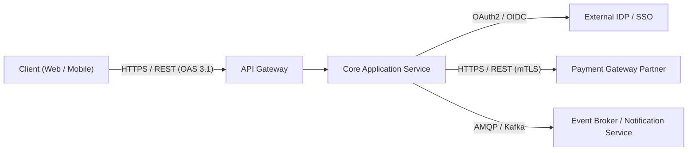

# Integration Overview & External Interface Specifications

**Hệ thống**: `[Project Name]`  
**Mục tiêu**: Định nghĩa chiến lược kết nối, giao thức truyền thông, chính sách retry, bảo mật và cơ chế chịu lỗi giữa hệ thống với các dịch vụ bên ngoài và các bên thứ ba.  
**Liên kết mục lục**: [00-document-index.md](00-document-index.md)

---

## 1. Bản đồ Tích hợp Hệ thống (Integration Topology Map)

---

## 2. Danh mục Giao diện Tích hợp (External Interface Registry)

| Mã Giao diện | Bên Tương tác | Mục đích Tích hợp | Giao thức & Định dạng | Cơ chế Xác thực | Thời gian Chờ (Timeout) | Cơ chế Xử lý Sự cố / Fallback |
| :---: | :--- | :--- | :--- | :--- | :--- | :--- |
| `INT-01` | **Client API** | Tiếp nhận yêu cầu nghiệp vụ từ người dùng | HTTPS / REST / JSON | JWT Bearer Token | `10s` | Báo lỗi chuẩn `ERR-xx-xxx`, rate-limit 100 req/min |
| `INT-02` | **External IDP** | Xác thực danh tính và lấy claims người dùng | HTTPS / OIDC | Client Credentials | `3s` | Caching JWKS public key, fallback token decode cục bộ |
| `INT-03` | **Payment Gateway** | Xử lý thanh toán và đối soát giao dịch | HTTPS / REST / JSON | API Key + Signature | `5s` | Retry 3 lần (Exponential Backoff), Circuit Breaker |
| `INT-04` | **Notification Service** | Gửi thông báo SMS / Email bất đồng bộ | Kafka / AMQP Event | SASL / SSL | Async | Dead Letter Queue (DLQ) sau 5 lần thử thất bại |

---

## 3. Quy chuẩn Khế ước API (API Contract Standards)

1. **Chuẩn Đặc tả**: Toàn bộ endpoints được định nghĩa bằng OpenAPI Specification 3.1 trong file [openapi.yaml](openapi.yaml).
2. **Phiên bản hóa API**: Tiền tố `/api/v1/` trong URL path. Khi có breaking change bắt buộc nâng cấp version `/api/v2/`.
3. **Idempotency Key**: Bắt buộc có header `Idempotency-Key: <UUIDv4>` đối với mọi API thay đổi trạng thái (POST, PUT, PATCH).
4. **Chuẩn Mã Lỗi**: Tuân thủ định dạng `ERR-{module_code}-{http_status_or_seq}`, ví dụ:
   - `ERR-00-400`: Lỗi dữ liệu đầu vào không hợp lệ (Validation Failure).
   - `ERR-00-401`: Lỗi chưa xác thực danh tính (Unauthorized).
   - `ERR-00-403`: Lỗi không có quyền truy cập tài nguyên (Forbidden).
   - `ERR-00-409`: Lỗi xung đột tài nguyên hoặc request đang xử lý (Conflict).
   - `ERR-00-500`: Lỗi hệ thống nội bộ không mong muốn (Internal Server Error).

---

## 4. Chính sách Kháng lỗi & Phục hồi (Resilience & Circuit Breaking)

- **Exponential Backoff**: Khi gọi đối tác thất bại do sự cố mạng, thời gian chờ thử lại lần lượt là: $1s \rightarrow 2s \rightarrow 4s$.
- **Circuit Breaker**:
  - Mở mạch (Open State) khi tỷ lệ lỗi của dịch vụ đối tác vượt quá **50%** trong cửa sổ 20 requests liên tiếp.
  - Chuyển sang Half-Open sau **30s** để kiểm tra thăm dò 1 request trước khi khép mạch trở lại.
