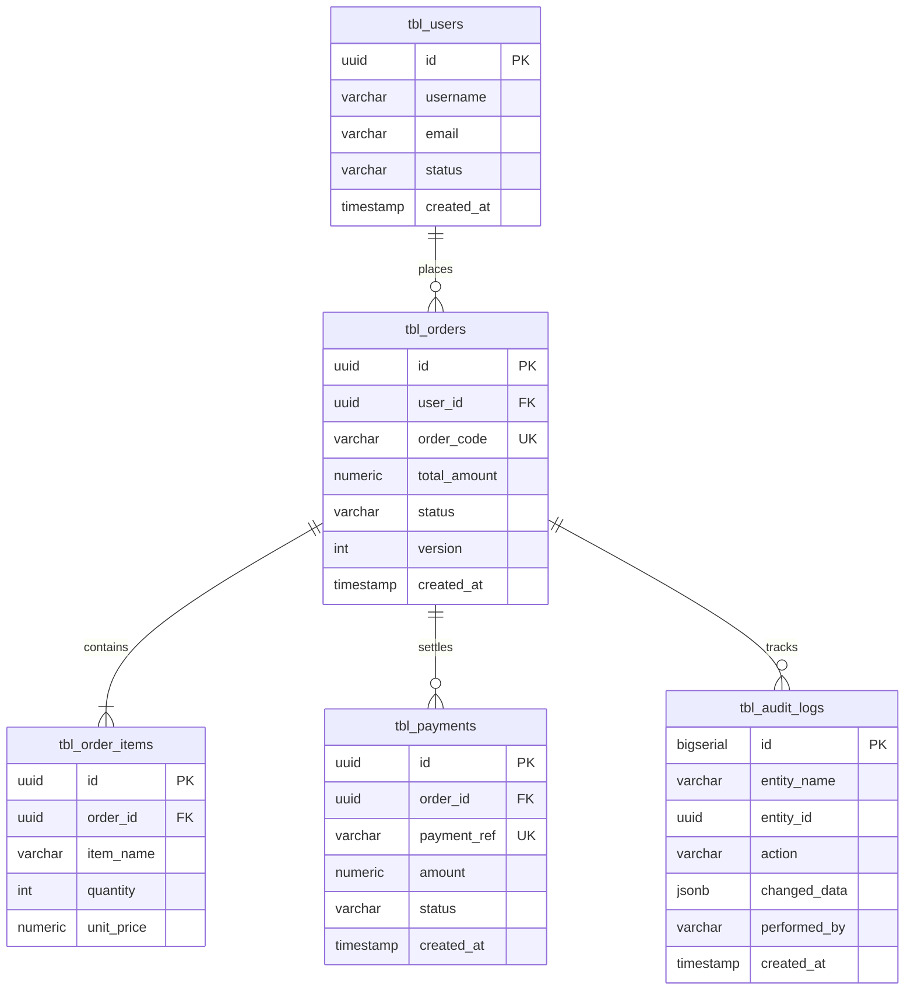

# Data Architecture & Storage Strategy

**Hệ thống**: `[Project Name]`  
**Mục tiêu**: Định nghĩa chiến lược dữ liệu, cơ sở dữ liệu quan hệ và phi quan hệ, phân vùng lưu trữ, bảo mật dữ liệu và ranh giới giao dịch (ACID).  
**Liên kết mục lục**: [00-document-index.md](00-document-index.md) | **Từ điển dữ liệu**: [data-dictionary.md](data-dictionary.md)

---

## 1. Công nghệ Lưu trữ & Ranh giới Dữ liệu (Storage Technologies)

> [!IMPORTANT]
> Công nghệ Cơ sở dữ liệu và Engine lưu trữ phải tuân thủ nghiêm ngặt theo TSD (Technical Specification Document), SAD hoặc các Architecture Decision Records (ADR-xxx). Không tự ý thay đổi Engine (ví dụ: TSD chốt SQL Server 2022 thì không được tự đổi sang PostgreSQL hoặc ngược lại).

| Tầng Dữ liệu | Công nghệ / Engine | Mục đích Sử dụng | Mô hình Nhất quán | Chiến lược Sao lưu (Backup) |
| :--- | :--- | :--- | :--- | :--- |
| **Operational DB (RDBMS)** | `[SQL Server 2022 / PostgreSQL 16+ / CSDL theo TSD]` | Lưu trữ dữ liệu thực thể nghiệp vụ cốt lõi | ACID (Strong Consistency) | Daily Snapshot + Transaction Log Archiving (RPO $\le 1$h) |
| **In-Memory Cache & Lock** | Redis 7+ | Caching truy vấn nóng, Distributed Lock | Eventual Consistency / Volatile | In-memory + AOF Persistence |
| **Audit & Log Store** | RDBMS (Partitioned Table) | Lưu vết kiểm toán bất biến (Append-only) | Strong Consistency | Read-only sau 30 ngày, lưu trữ lạnh 1 năm |

---

## 2. Mô hình Thực thể & Bounded Context Schemas (Entity Relationship Overview)

### 2.1 Phân chia Schema theo Bounded Context (Domain Schemas)

Hệ thống phân tách cơ sở dữ liệu thành các Schema độc lập theo từng Bounded Context để đảm bảo ranh giới dữ liệu và tính tự chủ của từng module:

| Schema / Bounded Context | Mục đích & Trách nhiệm Domain | Danh sách Bảng Trọng yếu | Ghi chú & Ràng buộc Khóa ngoại (Cross-schema) |
| :--- | :--- | :--- | :--- |
| `auth` / `identity` | Quản lý người dùng, định danh, phân quyền RBAC | `tbl_users`, `tbl_roles`, `tbl_permissions`, `tbl_user_roles` | Không foreign key cứng sang domain nghiệp vụ |
| `[domain_main]` (vd: `trip`, `order`) | Thực thể nghiệp vụ cốt lõi | `tbl_orders`, `tbl_order_items`, `tbl_trip_requests` | Lưu `user_id` dạng logical UUID, không enforce FK tầng DB |
| `settlement` / `payment` | Quản lý thanh toán, hóa đơn, quyết toán tài chính | `tbl_payments`, `tbl_invoices`, `tbl_settlements` | Bất biến (Immutable/Audit trail bắt buộc) |
| `system` / `audit` | Lưu vết kiểm toán toàn hệ thống, cấu hình tham số | `tbl_audit_logs`, `tbl_system_settings` | Partitioned append-only table |

### 2.2 Sơ đồ Quan hệ Thực thể (ERD)



---

## 3. Quản lý Giao dịch & Concurrency (Transaction Boundaries)

1. **Ranh giới Giao dịch**: Mọi hành động cập nhật trạng thái liên quan đến thanh toán hoặc xuất kho bắt buộc phải nằm trong 1 Database Transaction duy nhất (`BEGIN ... COMMIT`).
2. **Khóa Lạc quan (Optimistic Concurrency Control)**: Các bảng thực thể mutable sử dụng cột `version INT DEFAULT 0` để tránh Lost Update:
   ```sql
   UPDATE tbl_orders 
   SET status = 'CONFIRMED', version = version + 1 
   WHERE id = :order_id AND version = :current_version;
   ```
3. **Phân vùng Dữ liệu (Table Partitioning)**: Bảng `tbl_audit_logs` được phân vùng theo tháng (`RANGE (created_at)`) để đảm bảo hiệu năng truy vấn và dễ dàng dọn dẹp dữ liệu cũ.

---

## 4. An toàn Dữ liệu (Data Protection & Encryption)

- **Encryption At-Rest**: Toàn bộ database tablespaces được mã hóa chuẩn AES-256 ở tầng block storage.
- **Mã hóa Dữ liệu Nhạy cảm (Field-Level Encryption)**: Các trường PII (số điện thoại, căn cước, thông tin ngân hàng) phải được mã hóa trước khi ghi vào database qua khóa mã hóa quản lý tập trung (KMS).

---

## 5. Chiến lược Di trú CSDL & Quản lý Schema (Database Migration Strategy)

> [!IMPORTANT]
> Tất cả các thay đổi DDL (tạo bảng, thêm cột, tạo index, view) BẮT BUỘC phải được quản lý bằng kịch bản di trú (migration scripts) có versioning. Nghiêm cấm chạy câu lệnh DDL thủ công trực tiếp trên database staging/production.

### 5.1 Công cụ Di trú (Migration Tooling)
- **Công cụ chuẩn**: `[DbUp / EF Core Migrations / Flyway / Liquibase / Alembic tùy tech stack]`
- **Quy chuẩn đặt tên Script**: `V{YYYYMMDD_HHMMSS}__{Description}.sql` hoặc `V{Major}.{Minor}.{Patch}__{Description}.sql`
  - Ví dụ: `V20261111_010000__create_auth_and_users_tables.sql`
  - Ví dụ: `V20261111_020000__create_trip_requests_schema.sql`

### 5.2 Nguyên tắc Thực thi & Rollback
1. **Idempotency & Re-runnable**: Mọi script phải có điều kiện kiểm tra tồn tại (`IF NOT EXISTS`, `CREATE OR REPLACE`) hoặc được quản lý qua bảng kiểm soát version (`schema_versions` / `__EFMigrationsHistory`).
2. **Backward Compatibility (Expand & Contract Pattern)**: Khi chỉnh sửa schema (đổi tên cột, xóa cột), phải thực hiện qua 2 bước release để không làm gián đoạn service cũ đang chạy.
3. **CI/CD Automation**: Pipeline tự động thực thi migration trong bước deployment trước khi khởi động ứng dụng mới. Rollback script tương ứng `U{Version}__{Description}.sql` phải được chuẩn bị sẵn cho từng bản phát hành.
