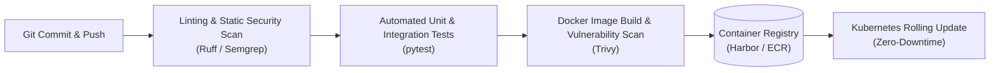

# Deployment & Operations Architecture (Kiến trúc Triển khai & Vận hành)

**Hệ thống**: `[Project Name]`  
**Mục tiêu**: Đặc tả kiến trúc triển khai hạ tầng, quy trình CI/CD, chiến lược container hóa, giám sát vận hành (Observability) và chỉ số phục hồi SLA.  
**Liên kết mục lục**: [00-document-index.md](00-document-index.md)

---

## 1. Môi trường Triển khai (Deployment Environments)

| Môi trường | Mục đích Sử dụng | Cấu hình Tài nguyên | Domain / Ingress | Cơ chế Triển khai |
| :--- | :--- | :--- | :--- | :--- |
| **Development** | Kiểm thử cục bộ & tích hợp tính năng của Dev | 1 Pod, DB Shared | `dev-api.local` | Tự động kích hoạt khi push code vào nhánh `develop` |
| **Staging** | Kiểm thử tải, UAT & bảo mật tiền phát hành | 2 Replicas, Multi-AZ DB | `staging-api.example.com` | Triển khai tự động khi tạo Pull Request vào `main` |
| **Production** | Môi trường phục vụ người dùng thực tế | Auto-scaling (2-10 Pods) | `api.example.com` | Triển khai Rolling Update / Canary qua phê duyệt thủ công |

---

## 2. Đường ống Tự động hóa CI/CD (Pipeline Architecture)

---

## 3. Khả năng Quan sát & Giám sát Vận hành (Observability)

### 3.1. Ba Trụ cột Quan sát (Metrics, Logs, Traces)
1. **Metrics**: Thu thập qua Prometheus client endpoint `/metrics`, trực quan hóa qua Grafana dashboards:
   - Tần suất request (RPS), Thời gian phản hồi (p50, p95, p99 latency), Tỷ lệ lỗi (Error rate 4xx/5xx).
   - Tải tài nguyên hệ thống: CPU utilization, Memory usage, Database Connection Pool saturation.
2. **Logs**: Ghi log có cấu trúc dạng JSON ra standard output (`stdout`), được gom tập trung qua Fluentd/Vector về Elasticsearch/Loki.
3. **Traces**: Tích hợp OpenTelemetry SDK, lan truyền `traceparent` qua các lời gọi HTTP/gRPC để tái hiện toàn bộ vết giao dịch phân tán.

### 3.2. Cảnh báo Sự cố (Alerting Rules)
- **Cảnh báo P0 (Khẩn cấp)**: Tỷ lệ lỗi 5xx vượt quá **5%** trong 2 phút liên tiếp $\rightarrow$ Bắn thông báo PagerDuty / Telegram ngay lập tức.
- **Cảnh báo P1 (Cảnh giác)**: Độ trễ p95 vượt quá **1,000ms** trong 5 phút $\rightarrow$ Thông báo kênh Slack Ops.

---

## 4. Cam kết Mức độ Dịch vụ (SLA / SLO / SLI)

- **Uptime SLA**: $\ge 99.9\%$ (tối đa không quá 43.8 phút downtime mỗi tháng).
- **RTO (Recovery Time Objective)**: $\le 30$ phút kể từ thời điểm phát hiện sự cố nghiêm trọng.
- **RPO (Recovery Point Objective)**: $\le 1$ giờ (dữ liệu tối đa có thể mất nếu toàn bộ cụm hạ tầng bị xóa sổ).
