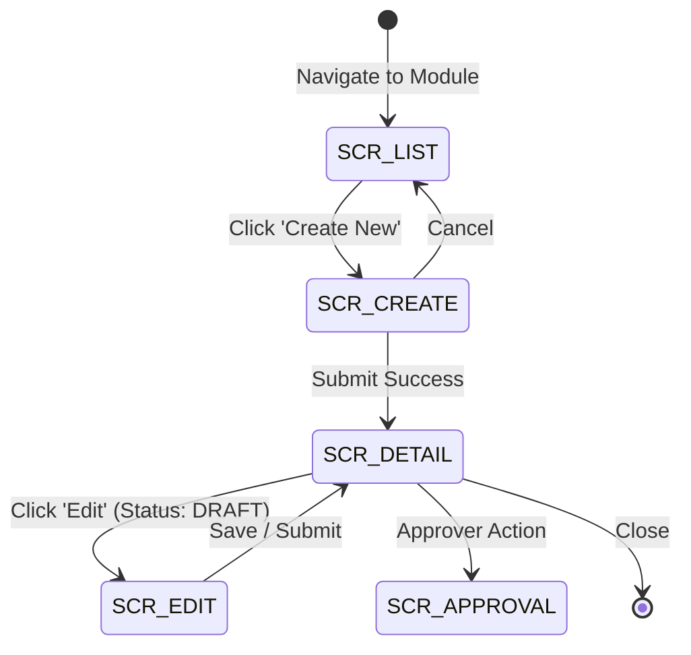

# Functional Specification Document (FSD): [Feature / Module Name]

## Metadata
- **Document ID**: `FSD-[MODULE]-[ID]`
- **System**: [System / Product Name]
- **Module**: [Module Name]
- **Date**: [YYYY-MM-DD]
- **Author**: `sdlc-ba-analysis`
- **Reviewed By**: `sdlc-sa-review`
- **Status**: `DRAFT | SUBMITTED | REWORK | APPROVED`
- **SRS Reference**: `artifacts/requirement-analysis.md` (or `artifacts/srs.md`)
- **JSON Specification**: `artifacts/fsd.json`
- **Standard Conformance**: `ISO/IEC/IEEE 29148:2018 §9.5 & IEEE 1016-2009 (Software Design Description)`

---

## 1. System Context & Screen Flow Navigation (IEEE 1016 §5.2)

### 1.1 Navigation Diagram

### 1.2 User Journey & Workflow Narrative
- **Primary Actor**: [e.g. Requester, Approver, Administrator]
- **Pre-conditions**: User is authenticated with corporate SSO; holds authorized role scope.
- **Trigger**: User initiates the workflow from web portal or mobile companion app.
- **Post-conditions**: Record persisted with immutable version snapshot; notification dispatched to downstream actor.

---

## 2. Functional Screen Specifications (ISO 29148 §9.5.3)

### Màn hình: `SCR-[MODULE]-[01]` - [Tên Màn Hình]
- **Mã Màn Hình (screen_id)**: `SCR-[MODULE]-[01]`
- **Module**: `[module_name]`
- **Route / URL**: `/app/[module]/[action]`
- **Responsive Viewport**: Desktop (1280px+), Mobile Mini-app (375px)
- **Authorized RBAC Roles**: `[Role1, Role2]`

#### Khối 1: Bố cục & Các phân vùng (Layout & Sections)
1. **Header Toolbar**: Breadcrumb navigation, Action buttons (`Save Draft`, `Submit`, `Cancel`).
2. **Summary Section**: Trạng thái chính, Mã phiếu / Request ID, Ngày tạo, Tổng giá trị dự toán.
3. **Form Detail Section**: Phân vùng thông tin người yêu cầu, thông tin chuyến đi / giao dịch.
4. **Table / Grid Section**: Danh sách các hạng mục chi tiết (line items).
5. **Footer / Action Bar**: Nút xác nhận lưu, gửi duyệt và hủy bỏ.

#### Khối 2: Bảng danh mục trường dữ liệu (Field Inventory Table - 8 cột)
| name | label | component_type | data_type | required | master_data_source | persistence_target | validation_rules |
|---|---|---|---|---|---|---|---|
| `trip_type` | Loại công tác | Dropdown | `VARCHAR(50)` | Yes | `GET /api/v1/master-data/trip-types` | `tbl_trip_request.trip_type` | Giá trị thuộc danh mục hợp lệ |
| `destination_id` | Địa điểm đến | Autocomplete | `UUID` | Yes | `GET /api/v1/locations?type=city` | `tbl_trip_request.destination_id` | Phải chọn từ danh sách gợi ý |
| `start_date` | Ngày bắt đầu | Datepicker | `DATE` | Yes | `N/A (user_input)` | `tbl_trip_request.start_date` | `>= today()` trừ khi có quyền backfill |
| `end_date` | Ngày kết thúc | Datepicker | `DATE` | Yes | `N/A (user_input)` | `tbl_trip_request.end_date` | `>= start_date` |
| `estimated_cost` | Dự trù chi phí | Textbox | `DECIMAL(18,2)` | Yes | `GET /api/v1/policy/rate-matrix` | `tbl_trip_request.estimated_cost` | `> 0`, tính theo định mức chính sách |
| `notes` | Ghi chú bổ sung | Textbox | `VARCHAR(500)` | No | `N/A (user_input)` | `tbl_trip_request.notes` | Tối đa 500 ký tự |

#### Khối 3: Hợp đồng nguồn dữ liệu Master Data (Data Contracts)
- **`GET /api/v1/master-data/trip-types`**:
  - Cache TTL: 3600s
  - Fallback: Local offline bundle
  - Response Schema: `[{ "id": string, "code": string, "name_vi": string, "is_active": boolean }]`
- **`GET /api/v1/locations?type=city`**:
  - Debounce: 300ms
  - Min search length: 2 chars
  - Response Schema: `[{ "id": string, "city_name": string, "province": string }]`

#### Khối 4: Ánh xạ cơ sở dữ liệu (Persistence Mapping)
- **Bảng tác động (`persistence_tables`)**: `tbl_trip_request`, `tbl_trip_itinerary`
- **Chi tiết mapping**:
  - `trip_type` -> `tbl_trip_request.trip_type` (`VARCHAR(50) NOT NULL`)
  - `destination_id` -> `tbl_trip_request.destination_id` (`UUID NOT NULL FK -> tbl_locations.id`)
  - `start_date` -> `tbl_trip_request.start_date` (`DATE NOT NULL`)
  - `end_date` -> `tbl_trip_request.end_date` (`DATE NOT NULL`)
  - `estimated_cost` -> `tbl_trip_request.estimated_cost` (`NUMERIC(18,2) NOT NULL DEFAULT 0`)
  - `notes` -> `tbl_trip_request.notes` (`VARCHAR(500) NULL`)

#### Khối 5: Logic tương tác, tính toán & sự kiện (Event Handlers)
- **`onLoad`**:
  1. Gọi API nạp Master Data danh mục loại công tác.
  2. Điền thông tin nhân viên đăng nhập vào phần Requester Profile.
  3. Mặc định `start_date = today()`.
- **`onChange`**:
  1. `destination_id` thay đổi: Gọi API tính toán khoảng cách và gợi ý định mức phụ cấp lưu trú.
  2. `start_date` hoặc `end_date` thay đổi: Tính số ngày công tác = `(end_date - start_date) + 1`. Tự động nhân đơn giá định mức để cập nhật `estimated_cost`.
  3. `trip_type == 'INTERNATIONAL'`: Bật hiển thị trường hộ chiếu và đơn vị tiền tệ ngoại tệ.
- **`onSubmit`**:
  1. Client-side validation toàn bộ các trường bắt buộc và định dạng dữ liệu.
  2. Kiểm tra ngân sách khả dụng qua `POST /api/v1/budget/check-hold`.
  3. Mở popup tóm tắt xác nhận trước khi gửi dữ liệu lên server.
