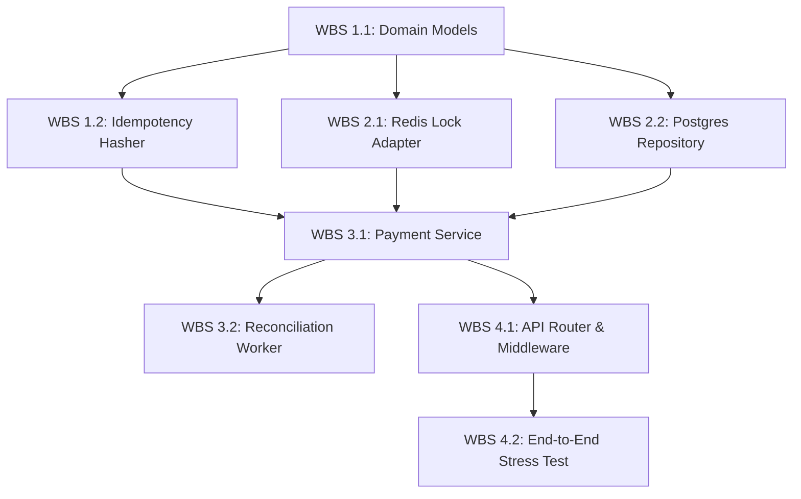

# Technical Implementation Plan & Work Breakdown Structure (WBS): [Feature Name]

## Metadata
- **Run ID**: `[run-id]`
- **Date**: `[YYYY-MM-DD]`
- **Author**: `sdlc-planner`
- **Reviewed By**: `sdlc-sa-review`, `sdlc-code-review`
- **Status**: `DRAFT | APPROVED`
- **Requirements Ref**: `artifacts/requirement-analysis.md`
- **Architecture Ref**: `artifacts/solution-design.md`
- **Standard Conformance**: `PMBOK Guide 7th Edition & IEEE 1058`

---

> [!WARNING]
> **Strict File Confinement Guardrail**: Implementers MUST confine modifications strictly to the files listed in the Work Package definitions below. Any file modification outside this declared scope will be rejected by the automated gate. Opportunistic refactoring or scope creep is strictly prohibited.

> [!NOTE]
> Conforms to the **Project Management Body of Knowledge (PMBOK Guide 7th Edition)** Work Breakdown Structure (WBS) standards and **IEEE 1058** for Software Project Execution.

---

## 1. Project Execution Framework & Runtime Context

### 1.1 Implementation Goal & Scope Boundary
Implement the idempotent payment authorization flow conforming to `artifacts/requirement-analysis.md` (FR-001, FR-002) and `artifacts/solution-design.md` (AD-001, AD-002).

### 1.2 Target Runtime, Dependencies & Environment
- **Runtime Environment**: Python 3.11+ / asyncio
- **Core Dependencies**:
  - `redis>=5.0.0` (distributed mutex and token caching)
  - `pydantic>=2.6.0` (strict payload validation)
  - `sqlalchemy>=2.0.0` (Postgres ledger persistence)
  - `pytest>=8.0.0`, `pytest-asyncio>=0.23.0` (test harness)
- **Branch & Isolation Protocol**:
  - Working Branch: `feat/[run-id]-payment-idempotency`
  - Workspace: Dedicated Git worktree or isolated container directory

---

## 2. Global Implementation Guardrails & Quality Law

1. **File Confinement**: Modifying files outside the declared WBS package boundaries results in an immediate code-review pushback.
2. **Strict Red-Green-Refactor TDD**: Every behavioral change MUST begin with a committed, failing test reproducing the requirement before writing the implementation.
3. **No Muted Checks**: Linters (`ruff`), static type checkers (`mypy`), and test runners must run clean with exit code `0`. Suppressions (`# noqa`, `# type: ignore`) require explicit justification.
4. **Deterministic Evidence**: All claims of passing steps must cite command executions, timestamps, and exit statuses.

---

## 3. Review Focus & Top Implementation Failure Modes

| Risk ID | Failure Mode | Mitigation Strategy in Tasks |
|---|---|---|
| **RF-001** | Concurrent requests with identical idempotency key both execute charge | Acquire Redis distributed lock before entering DB transaction; enforce DB unique constraint |
| **RF-002** | Payload tampering with reused idempotency key succeeds | Compute SHA-256 hash of payload and verify match before serving cached response |
| **RF-003** | Upstream gateway socket timeout drops transaction without status check | Wrap external calls in timeout handler; flag transaction for background reconciliation |

---

## 4. Work Breakdown Structure (WBS) & Dependency Graph

### 4.1 Hierarchical Work Breakdown Structure (WBS)
- **1.0 Data & Domain Model Foundation**
  - 1.1 Domain Aggregate & Status Enum (`payments/domain/model.py`)
  - 1.2 Idempotency Hash Calculation Utility (`payments/domain/idempotency.py`)
- **2.0 Infrastructure & Persistence Adapters**
  - 2.1 Redis Mutex & Cache Adapter (`payments/infrastructure/cache/redis.py`)
  - 2.2 PostgreSQL Ledger & Outbox Repository (`payments/infrastructure/db/repository.py`)
- **3.0 Application & Use Case Orchestration**
  - 3.1 Authorize Payment Service Handler (`payments/application/service.py`)
  - 3.2 In-Flight Reconciliation Worker (`payments/application/reconciliation.py`)
- **4.0 Presentation & Integration Verification**
  - 4.1 FastAPI Router & Middleware Validation (`payments/presentation/router.py`)
  - 4.2 End-to-End Concurrent Stress Tests (`tests/integration/test_idempotency_race.py`)

### 4.2 Dependency Graph


---

## 5. Detailed Work Packages & Task Specifications

### WBS 1.1: Core Domain Entities & State Machine
- **Package ID**: `WBS 1.1`
- **Requirements Covered**: `FR-001`, `BR-001`
- **Architecture Decisions Enforced**: `AD-001`
- **Target Files**:
  - **Create**: `src/payments/domain/model.py`
  - **Create**: `tests/unit/test_payment_model.py`
- **Interfaces**:
  - **Consumes**: Python standard library `enum`, `dataclasses`, `uuid`, `datetime`
  - **Produces**:
    ```python
    class PaymentStatus(Enum):
        PENDING = "PENDING"
        PROCESSING = "PROCESSING"
        AUTHORIZED = "AUTHORIZED"
        FAILED = "FAILED"

    @dataclass
    class PaymentTransaction:
        id: str
        account_id: str
        amount_cents: int
        currency: str
        status: PaymentStatus
        idempotency_key: str
        payload_hash: str
        def transition_to(self, new_status: PaymentStatus) -> None: ...
    ```
- **TDD Execution Steps**:
  - [ ] **Step 1: Write failing test**
    - File: `tests/unit/test_payment_model.py`
    - Test Case: `test_invalid_state_transition_raises_domain_error()`
  - [ ] **Step 2: Run test to verify RED failure**
    - Command: `pytest tests/unit/test_payment_model.py`
    - Expected Output: `FAILED (ImportError: cannot import name 'PaymentTransaction')`
  - [ ] **Step 3: Implement minimal code**
    - File: `src/payments/domain/model.py`
    - Implement `PaymentTransaction` and invalid state transition guards.
  - [ ] **Step 4: Run test to verify GREEN pass**
    - Command: `pytest tests/unit/test_payment_model.py`
    - Expected Output: `1 passed in 0.05s`
  - [ ] **Step 5: Code quality check**
    - Command: `ruff check src/payments/domain/ && mypy src/payments/domain/`
    - Expected Output: `All checks passed!`
- **Rollback Plan**: Delete `src/payments/domain/model.py` and `tests/unit/test_payment_model.py`.

---

### WBS 2.1: Redis Distributed Lock & Cache Adapter
- **Package ID**: `WBS 2.1`
- **Requirements Covered**: `FR-001`, `NFR-001`
- **Architecture Decisions Enforced**: `AD-001`
- **Target Files**:
  - **Create**: `src/payments/infrastructure/cache/redis_lock.py`
  - **Create**: `tests/unit/test_redis_lock.py`
- **Interfaces**:
  - **Consumes**: `redis.asyncio.Redis`
  - **Produces**:
    ```python
    class RedisIdempotencyLock:
        async def acquire_lock(self, key: str, ttl_seconds: int = 60) -> bool: ...
        async def release_lock(self, key: str) -> None: ...
        async def get_cached_response(self, key: str) -> dict | None: ...
        async def store_response(self, key: str, payload: dict, ttl_seconds: int = 86400) -> None: ...
    ```
- **TDD Execution Steps**:
  - [ ] **Step 1: Write failing test**
    - File: `tests/unit/test_redis_lock.py`
    - Test Case: `test_acquire_lock_prevents_concurrent_reentry()`
  - [ ] **Step 2: Run test to verify RED failure**
    - Command: `pytest tests/unit/test_redis_lock.py`
    - Expected Output: `FAILED (ModuleNotFoundError: No module named 'redis_lock')`
  - [ ] **Step 3: Implement minimal code**
    - File: `src/payments/infrastructure/cache/redis_lock.py`
    - Implement Redis `SET key value NX EX` lock and response caching.
  - [ ] **Step 4: Run test to verify GREEN pass**
    - Command: `pytest tests/unit/test_redis_lock.py`
    - Expected Output: `1 passed in 0.08s`
  - [ ] **Step 5: Code quality check**
    - Command: `ruff check src/payments/infrastructure/ && mypy src/payments/infrastructure/`
    - Expected Output: `All checks passed!`

---

### WBS 3.1: Authorize Payment Application Service
- **Package ID**: `WBS 3.1`
- **Requirements Covered**: `FR-001`, `BR-001`, `NFR-003`
- **Architecture Decisions Enforced**: `AD-001`, `AD-002`
- **Target Files**:
  - **Create**: `src/payments/application/service.py`
  - **Modify**: `src/payments/application/__init__.py:1-10`
  - **Create**: `tests/integration/test_payment_service.py`
- **Interfaces**:
  - **Consumes**: `PaymentTransaction`, `RedisIdempotencyLock`, `PaymentRepository`, `GatewayAdapter`
  - **Produces**: `async def authorize_payment(cmd: AuthorizePaymentCommand) -> PaymentResult`
- **TDD Execution Steps**:
  - [ ] **Step 1: Write failing test**
    - File: `tests/integration/test_payment_service.py`
    - Test Case: `test_duplicate_payment_returns_cached_result_without_second_charge()`
  - [ ] **Step 2: Run test to verify RED failure**
    - Command: `pytest tests/integration/test_payment_service.py`
    - Expected Output: `FAILED (AttributeError: 'PaymentService' object has no attribute 'authorize_payment')`
  - [ ] **Step 3: Implement minimal code**
    - File: `src/payments/application/service.py`
    - Coordinate lock acquisition, duplicate checking, gateway authorization, DB transaction, and response caching.
  - [ ] **Step 4: Run test to verify GREEN pass**
    - Command: `pytest tests/integration/test_payment_service.py`
    - Expected Output: `1 passed in 0.15s`
  - [ ] **Step 5: Code quality check**
    - Command: `ruff check src/payments/application/ && mypy src/payments/application/`
    - Expected Output: `All checks passed!`

---

## 6. Verification Gates & Quality Sign-Off Commands

| Quality Gate | Exact Command Line | Exit Criterion | Timeout |
|---|---|---|---|
| **Unit Test Suite** | `pytest tests/unit/ -v --maxfail=1` | Exit 0, 100% tests passing | 30s |
| **Integration Test Suite** | `pytest tests/integration/ -v` | Exit 0, 0 failures, 0 errors | 60s |
| **Concurrent Race Condition Test** | `pytest tests/integration/test_idempotency_race.py` | Exit 0, 0 duplicate charges | 45s |
| **Linter & Code Style** | `ruff check src/ tests/` | Exit 0, 0 linter violations | 15s |
| **Static Type Enforcement** | `mypy src/ tests/` | Exit 0, "Success: no issues found" | 30s |
| **Test Coverage Threshold** | `pytest --cov=src/payments --cov-report=term --cov-fail-under=85` | Exit 0, line coverage >= 85% | 60s |

---

## 7. Pre-Implementation Verification & Red-Team Log

> Synchronized with machine-checkable sidecar `artifacts/plan-verification.json` (validated via `sdlc-harness verify-plan --run-id [run-id]`).

### 7.1 Codebase Verification Claims (4 Roles)

| Claim ID | Verification Role | Claim Description | Status | Evidence Ref (`file:line`) | Symbol |
|---|---|---|---|---|---|
| **CLM-001** | `FACT_CHECKER` | Existing module `src/payments/application/__init__.py` exports application handlers | `VERIFIED` | `src/payments/application/__init__.py:1-10` | `__all__` |
| **CLM-002** | `FLOW_TRACER` | Payment authorization checks idempotency lock before invoking gateway adapter | `VERIFIED` | `artifacts/solution-design.md:1-20` | - |
| **CLM-003** | `SCOPE_AUDITOR` | Redis lock instance is stateless per request key and does not leak mutable state | `VERIFIED` | `artifacts/solution-design.md:1-20` | - |
| **CLM-004** | `CONTRACT_VERIFIER` | All callers of `authorize_payment` pass `AuthorizePaymentCommand` with `idempotency_key` | `VERIFIED` | `src/payments/application/__init__.py:1-10` | - |

### 7.2 Adversarial Red-Team Findings (Evidence-Filtered)

| Finding ID | Hostile Lens | Severity | Finding & Attack Scenario | Evidence Ref (`file:line`) | Disposition | Resolution in Plan |
|---|---|---|---|---|---|---|
| **RT-001** | `SECURITY_ADVERSARY` | `HIGH` | Reusing `idempotency_key` with modified `amount_cents` could bypass check if payload hash is omitted | `artifacts/implementation-plan.md:50-58` | `ACCEPTED` | Added `payload_hash` SHA-256 verification in WBS 1.1 and WBS 3.1 |
| **RT-002** | `ASSUMPTION_DESTROYER` | `MEDIUM` | Redis lock TTL could expire during slow upstream gateway call | `artifacts/implementation-plan.md:142-158` | `ACCEPTED` | Enforced DB unique constraint on `idempotency_key` in WBS 3.1 |

### 7.3 Whole-Plan Consistency Sweep & Decision Deltas

- **Decision Deltas Applied**:
  - `WBS 1.1 & WBS 3.1`: Upgraded idempotency verification from key-only lookup to key + SHA-256 `payload_hash` comparison.
- **Unresolved Contradictions**: `0`

