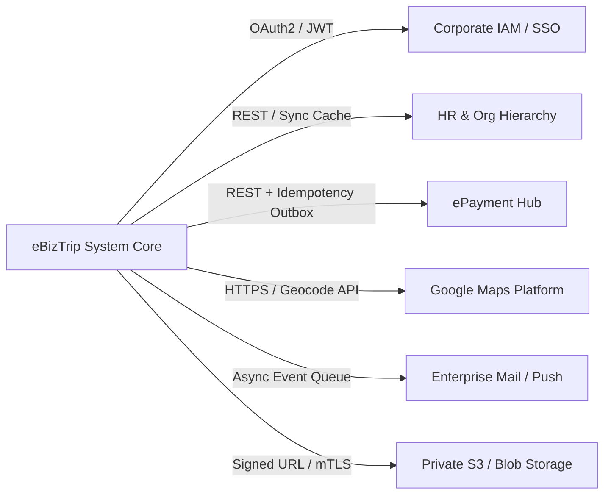

# External Interface Specification & Integration Matrix

## Metadata
- **System**: [System Name]
- **Document ID**: `INT-SPEC-[MODULE]`
- **Date**: [YYYY-MM-DD]
- **Author**: `sdlc-ba-analysis`
- **Reviewed By**: `sdlc-sa-review`
- **Standard Conformance**: `ISO/IEC/IEEE 29148:2018 §9.5.3.1 (External Interfaces) & IEEE 1016-2009`

---

## 1. External System Landscape & Boundary Topology



| External System | Provider / Domain Owner | Trust Boundary | Primary Protocol | Criticality Tier | Impact of Downtime |
|---|---|---|---|---|---|
| **Corporate IAM** | Group IT Security | Internal Corporate | OAuth2.0 / OpenID Connect | **Tier 1 (Mission-Critical)**| Blocks all user logins; session token validation fails |
| **HR Master Data**| Corporate HR | Internal Corporate | REST API / HTTPS | **Tier 2 (High)** | Degradation to cached org hierarchy (TTL 24h) |
| **ePayment Hub** | Group Finance | Internal Financial | REST API + Outbox worker | **Tier 1 (Mission-Critical)**| Submission proceeds (skipped check); final approval blocked |
| **Google Maps** | Google Cloud Platform | External Public Cloud| HTTPS / JSON API | **Tier 3 (Medium)** | Fallback to manual distance entry with mandatory audit reason |
| **Document Blob**| Corporate Infra | Internal Private Cloud| S3 API / IAM Role | **Tier 2 (High)** | File upload/download queued or temporarily rejected |

---

## 2. Detailed Interface Contracts & Data Exchange Specifications (ISO 29148 §9.5.3.1)

### 2.1 Interface: `INT-01` - ePayment Budget Reservation
- **Direction**: Outbound (Local -> ePayment)
- **Invocation Mode**: Asynchronous via Transactional Outbox Worker
- **Transport & Format**: HTTPS / JSON
- **Authentication**: mTLS + Bearer Token (Vault-issued service credentials)
- **Endpoint**: `POST /api/v2/budgets/reservations`
- **Idempotency Header**: `Idempotency-Key: ebiz_<request_id>_<version_hash>`
- **Request Payload Contract**:
  ```json
  {
    "system_source": "EBIZTRIP",
    "transaction_ref": "TRP-2026-00128",
    "cttv_code": "FPT_IS",
    "cost_center_code": "CC-10482",
    "amount": 15000000.00,
    "currency": "VND",
    "fiscal_period": "2026-10",
    "action": "RESERVE"
  }
  ```
- **Response Handling Contract**:
  - `HTTP 200 OK`: `{"reservation_id": "RSV-99281", "status": "CONFIRMED"}` -> Mark local state `RESERVED`.
  - `HTTP 422 Unprocessable`: Insufficient budget -> If strict-mode: block approval; non-strict: alert & log.
  - `HTTP 5xx / Timeout (3000ms)`: Do not retry synchronously. Keep transaction pending; reconciliation worker queries `/reservations?transaction_ref=TRP-2026-00128`.

---

## 3. Reliability, Resilience & Failure Patterns (ISO 29148 §9.5.3.3)

| Interface ID | Target System | SLA Latency (p95 / p99) | Timeout | Retry Policy | Circuit Breaker | Failure Fallback Strategy |
|---|---|---|---|---|---|---|
| `INT-01` | ePayment | 800ms / 2000ms | 3000ms | 3 retries (exp backoff: 1s, 2s, 4s + jitter) | Trip after 5 failures in 30s | Outbox queue; reconciliation job sweeps every 5 mins |
| `INT-02` | Google Maps | 300ms / 800ms | 1500ms | 2 retries | Trip after 10 failures | Degrade to manual distance entry with required justification |
| `INT-03` | HR Master Data | 500ms / 1500ms | 2000ms | 3 retries | Disabled | Serve from in-memory Redis cache (stale TTL up to 24h) |
| `INT-04` | Notifications | 1000ms / 3000ms | 5000ms | 5 retries with dead-letter queue | Trip after 20 failures | Dead-letter queue; admin alert; no user blocking |
