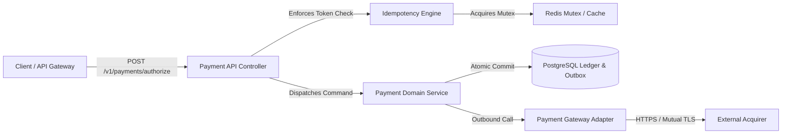
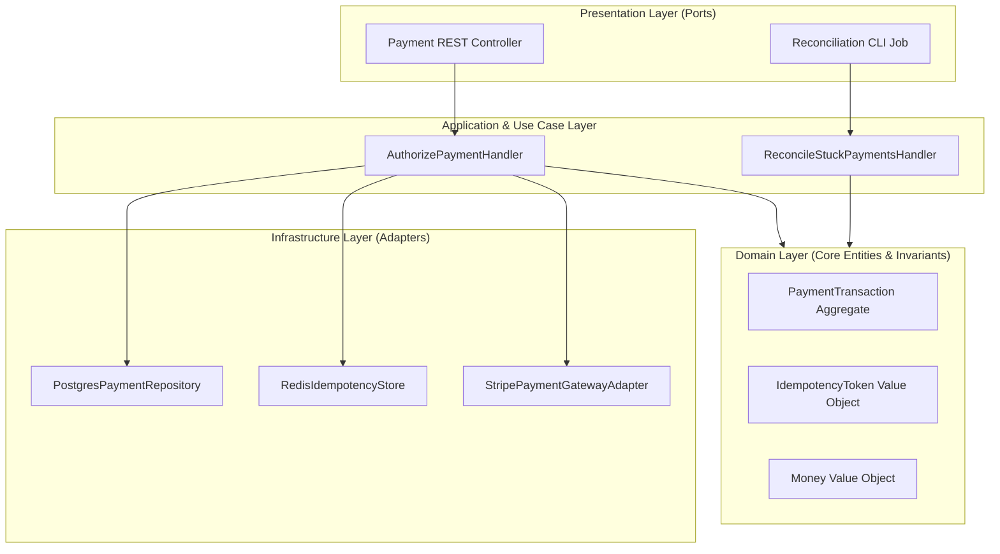
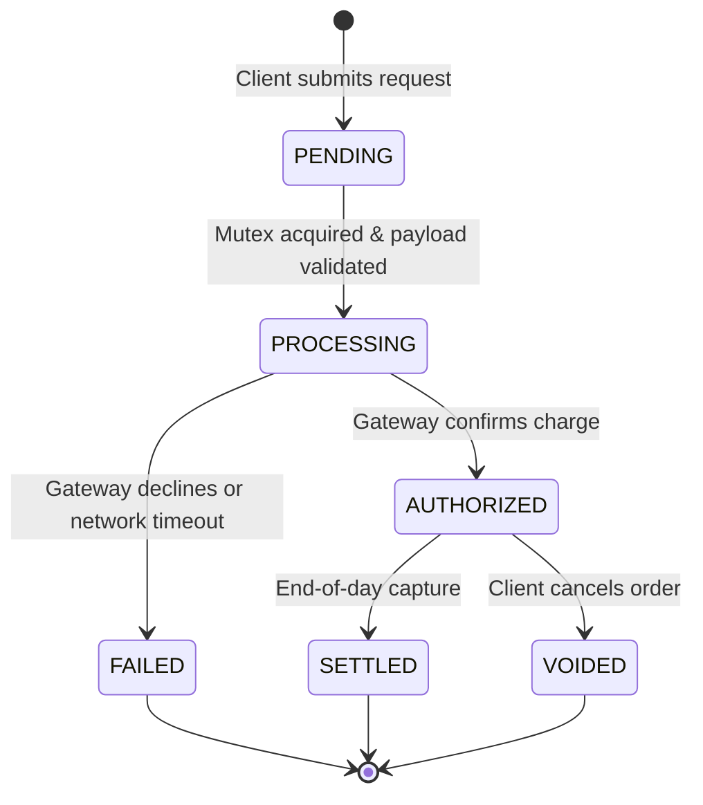
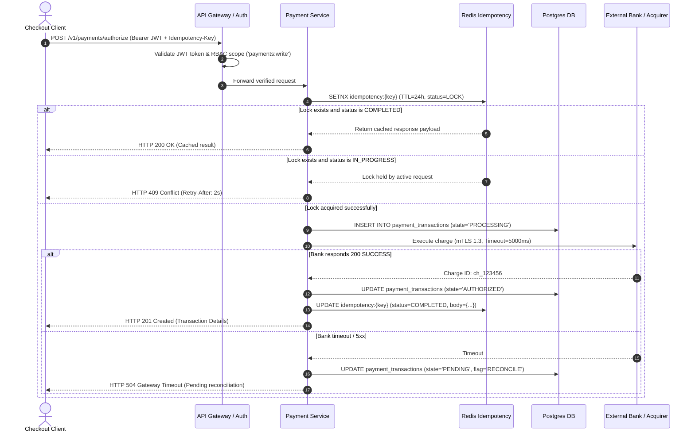
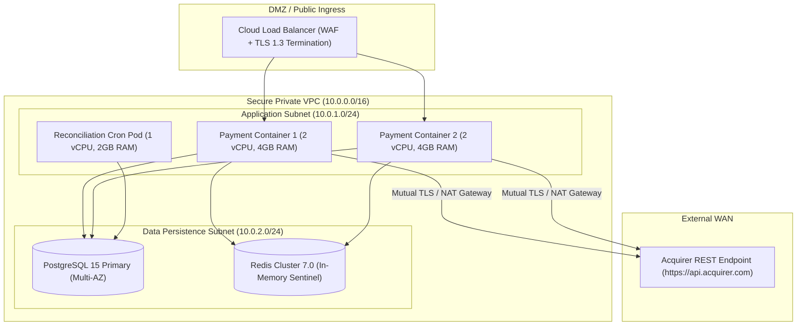

# Technical Solution Design & Architecture Specification: [Feature / System Name]

## Metadata
- **Run ID**: `[run-id]`
- **Date**: `[YYYY-MM-DD]`
- **Author**: `sdlc-sa-design`
- **Reviewed By**: `sdlc-sa-review`, `sdlc-security-review`
- **Status**: `DRAFT | REVIEW | APPROVED`
- **Requirements Reference**: `artifacts/requirement-analysis.md`
- **Standard Conformance**: `IEEE 1016:2009 & Kruchten 4+1 Architectural View Model`

---

> [!IMPORTANT]
> **Architectural Invariant Law**: Architecture Decision Records (`AD-xxx`) and Component Boundary Invariants defined herein are strictly binding. Downstream Implementers and Reviewers must not alter component boundaries, introduce unauthorized circular imports, or bypass idempotency gates without an approved Architectural Revision.

> [!NOTE]
> Conforms to **IEEE 1016:2009** (Standard for Information Technology — Systems Design — Software Design Descriptions) and the **Kruchten 4+1 Architectural View Model**.

---

## 1. System Context & Architecture Overview

### 1.1 Executive Summary
This specification defines the architectural blueprint for the idempotent transaction processing engine. The system coordinates incoming client authorization requests, enforces deduplication via distributed cache, records an immutable transactional outbox, and manages gateway communication with fault tolerance.

### 1.2 Architecture Style & System Topology
- **Architecture Style**: Modular Monolith with Ports & Adapters (Hexagonal Architecture) and Transactional Outbox.
- **Topology Overview**:


---

## 2. Kruchten 4+1 Architectural Views

### 2.1 Logical View (Static Structure & Domain Decomposition)
Decomposes the system into isolated domain boundaries. Outer layers depend inward; the domain core has zero infrastructure dependencies.



#### Component Responsibilities & Boundary Invariants
| Component | Primary Responsibility | Allowed Interactions | Boundary Invariants (What it MUST NOT do) |
|---|---|---|---|
| `PaymentController` | HTTP request routing, header parsing, serialization | Invokes `AuthorizePaymentHandler` | MUST NOT execute business logic or database queries directly |
| `IdempotencyEngine` | Hash calculation, deduplication lock management | Reads/writes `IdempotencyStore` | MUST NOT modify transaction settlement state |
| `PaymentAggregate` | Enforces state machine transitions and financial rules | In-memory domain operations only | Zero network or disk I/O; pure domain logic |
| `GatewayAdapter` | Serializes external vendor payload, handles mTLS | Communicates with External Acquirer | MUST NOT write to application database directly |

---

### 2.2 Development View (Codebase Structure & Package Topology)
Enforces file hierarchy, strict layering, and dependency isolation:

```text
src/
└── payments/
    ├── domain/               # Zero dependencies; pure business rules
    │   ├── __init__.py
    │   ├── model.py          # PaymentTransaction, PaymentStatus
    │   └── exceptions.py     # DomainValidationError, StateTransitionError
    ├── application/          # Use case orchestrators
    │   ├── __init__.py
    │   ├── commands.py       # AuthorizePaymentCommand
    │   └── service.py        # PaymentService, ReconciliationService
    ├── infrastructure/       # External ports realization
    │   ├── __init__.py
    │   ├── db/               # PostgreSQL SQLAlchemy models & migrations
    │   ├── cache/            # Redis idempotency lock adapter
    │   └── gateway/          # Acquirer HTTP client
    └── presentation/         # Incoming interfaces
        ├── __init__.py
        ├── router.py         # FastAPI/Flask HTTP routes
        └── schemas.py        # Pydantic/dataclass payload validation
```

**Development Layering Rules**:
1. Modules in `domain/` MUST NEVER import from `application/`, `infrastructure/`, or `presentation/`.
2. All database entities MUST implement `to_domain()` and `from_domain()` mapping routines.
3. Tests must be structured identically under `tests/unit/`, `tests/integration/`, and `tests/contract/`.

---

### 2.3 Process View (Concurrency, Lifecycle & Sequence Diagrams)

#### State Transition Machine


#### Authentication & Transaction Handshake Sequence Diagram


---

### 2.4 Physical / Deployment View (Infrastructure & Network Topology)
Maps software units onto physical and containerized infrastructure:



---

### 2.5 Scenarios / Use Case Realization (+1 View)
- **Realization of FR-001 (Idempotent Payment)**: Coordinated via Section 2.3 Sequence Diagram steps 1 through 14.
- **Realization of FR-002 (Reconciliation Job)**: Background Cron Pod queries `payment_transactions` WHERE `state = 'PENDING'` AND `created_at < NOW() - INTERVAL '60 SECONDS'`.

---

## 3. Technical Specifications (TSD)

### 3.1 API & Interface Contracts

#### `POST /v1/payments/authorize`
- **Headers**:
  - `Authorization: Bearer <jwt_token>` (Required, scopes: `payments:write`)
  - `Idempotency-Key: <uuid-v4>` (Required, length 36)
  - `Content-Type: application/json`

- **Request Schema (JSON Schema draft 2020-12)**:
```json
{
  "$schema": "https://json-schema.org/draft/2020-12/schema",
  "type": "object",
  "required": ["account_id", "amount_cents", "currency", "payment_method"],
  "properties": {
    "account_id": { "type": "string", "pattern": "^acc_[a-zA-Z0-9]{16}$" },
    "amount_cents": { "type": "integer", "minimum": 1, "maximum": 100000000 },
    "currency": { "type": "string", "enum": ["USD", "EUR", "GBP", "VND"] },
    "payment_method": {
      "type": "object",
      "required": ["type", "token"],
      "properties": {
        "type": { "type": "string", "enum": ["card_token", "saved_instrument"] },
        "token": { "type": "string", "minLength": 10 }
      }
    }
  },
  "additionalProperties": false
}
```

- **Response Payloads**:
  - `201 Created` (Success):
    ```json
    {
      "transaction_id": "tx_9988776655",
      "status": "AUTHORIZED",
      "amount_cents": 5000,
      "currency": "USD",
      "created_at": "2026-10-06T12:00:00Z"
    }
    ```
  - `409 Conflict` (Concurrent duplicate execution in flight):
    ```json
    {
      "error": "CONCURRENT_REQUEST",
      "message": "A transaction with this idempotency key is currently processing. Retry shortly."
    }
    ```

---

### 3.2 Database & Storage Architecture

#### Schema DDL (PostgreSQL 15+)
```sql
CREATE TYPE payment_status_enum AS ENUM (
    'PENDING', 'PROCESSING', 'AUTHORIZED', 'FAILED', 'SETTLED', 'VOIDED'
);

CREATE TABLE payment_transactions (
    id VARCHAR(36) PRIMARY KEY,
    account_id VARCHAR(32) NOT NULL,
    amount_cents BIGINT NOT NULL CHECK (amount_cents > 0),
    currency CHAR(3) NOT NULL,
    status payment_status_enum NOT NULL DEFAULT 'PENDING',
    idempotency_key VARCHAR(64) NOT NULL,
    idempotency_hash CHAR(64) NOT NULL,
    gateway_reference VARCHAR(128),
    created_at TIMESTAMPTZ NOT NULL DEFAULT NOW(),
    updated_at TIMESTAMPTZ NOT NULL DEFAULT NOW(),
    CONSTRAINT uk_payment_idempotency UNIQUE (idempotency_key)
);

CREATE INDEX idx_payment_account ON payment_transactions (account_id, created_at DESC);
CREATE INDEX idx_payment_pending_recon ON payment_transactions (status, created_at)
    WHERE status = 'PENDING';
```

---

## 4. Architecture Decision Records (ADR)

### AD-001: Two-Tier Redis Mutex and Postgres Ledger for Idempotency
- **Context**: High concurrency checkouts risk double charges if network retries occur while the first charge is executing in the external payment gateway.
- **Decision**: Adopt a dual-tier approach: Redis `SETNX` distributed lock with 60s TTL for real-time concurrency gating, paired with a persistent PostgreSQL unique constraint (`uk_payment_idempotency`) for 24-hour durable deduplication.
- **Alternatives Considered**:
  - *Database-only optimistic locking*: Rejected due to high row-level contention and DB connection pool saturation under 1,000+ RPS surges.
  - *Redis-only cache*: Rejected because Redis restarts or cache evictions could cause duplicate charges.
- **Binds**: Binds `src/payments/infrastructure/cache/` and `src/payments/infrastructure/db/`.
- **Prevents**: Prevents race conditions during simultaneous identical payment submissions.
- **Enforceable Rule**: All write routes MUST require `Idempotency-Key` validated through `IdempotencyMiddleware`. CI integration test `tests/integration/test_idempotency_race.py` must pass with 20 parallel threads.

### AD-002: Transactional Outbox for State Change Events
- **Context**: State changes must notify downstream billing and notification services without distributed two-phase commits.
- **Decision**: Write domain events to an append-only `outbox_events` table inside the exact same database transaction that updates `payment_transactions`. A background worker polls and dispatches events.
- **Alternatives Considered**:
  - *Direct publishing to Kafka/RabbitMQ in request loop*: Rejected due to dual-write hazard (database commits but message broker unavailable).
- **Binds**: Payment state machine transitions.
- **Prevents**: Prevents ghost transactions and split-brain event states.
- **Enforceable Rule**: No domain event publisher shall be invoked directly outside DB transaction commit hooks.

---

## 5. Resilience, Error Handling & Failure Modes

| Failure Mode | Detection Mechanism | Mitigation & Fallback | Recovery SLA / Strategy |
|---|---|---|---|
| **Redis Cluster Outage** | ConnectionTimeoutException (> 50ms) | Fail-open to DB-level unique constraint locking; log warning | SLA: 0 duplicate charges; 100% DB failover |
| **Gateway Timeout (> 5s)** | SocketTimeoutException | Mark transaction `PENDING (RECONCILE)`; return 504 with retry token | Reconciled within 60 seconds by background worker |
| **Database Deadlock** | Postgres SQLSTATE 40P01 | Exponential backoff retry (3 attempts: 50ms, 100ms, 200ms) | Resolved in < 500ms; escalate if 3 attempts fail |

---

## 6. Operational Envelope & NFR Realization

### 6.1 Performance Realization (NFR-001)
- Redis cache hits return cached responses in < 15ms.
- Database connection pool configured with HikariCP / asyncpg pool size = 50 per container.
- Prepared SQL statements eliminate query parsing overhead.

### 6.2 Security & Compliance Realization (NFR-002)
- Zero persistence of raw credit card PAN or CVV; only opaque tokens stored.
- TLS 1.3 enforced for all external ingress and egress; cipher suites restricted to AES-GCM and ChaCha20.
- All logs scrubbed for sensitive headers (`Authorization`, `Cookie`, `X-Card-Token`).

### 6.3 Observability & Telemetry (NFR-004)
- OpenTelemetry instrumentation on all HTTP controllers, DB queries, and external gateway requests.
- Structured log format: `{"timestamp": "...", "trace_id": "...", "span_id": "...", "event": "payment_authorized", "amount": 5000}`.

---

## 7. Technical Risks & Validation Spikes

| Risk ID | Description | Impact | Mitigation / Validation Spike |
|---|---|---|---|
| **TR-001** | Gateway API latency spike under holiday traffic load (> 3s) | Degraded user experience | Implement adaptive circuit breaker with 20% error rate tripping threshold |
| **TR-002** | Clock skew between Redis nodes causing premature lock expiration | Concurrency race condition | NTP daemon synchronization enforced with max skew threshold of 5ms |
